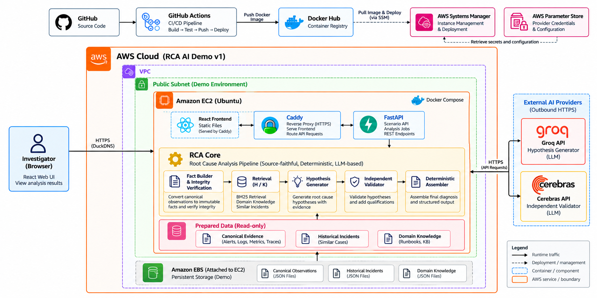
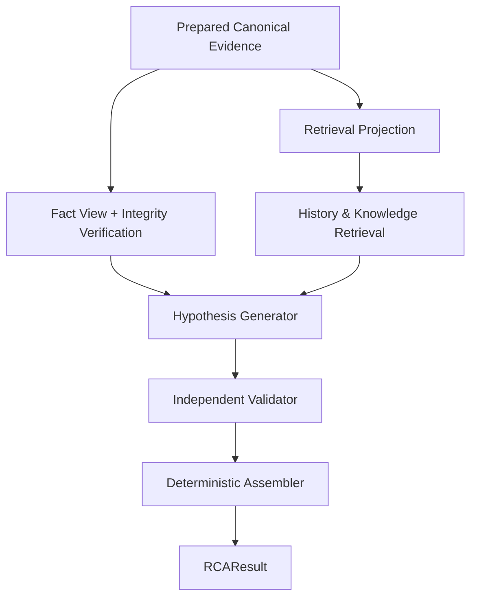
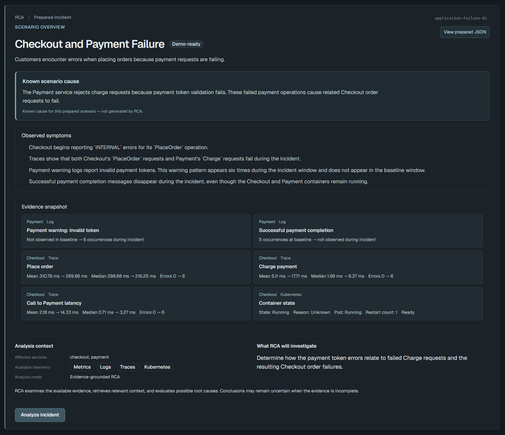
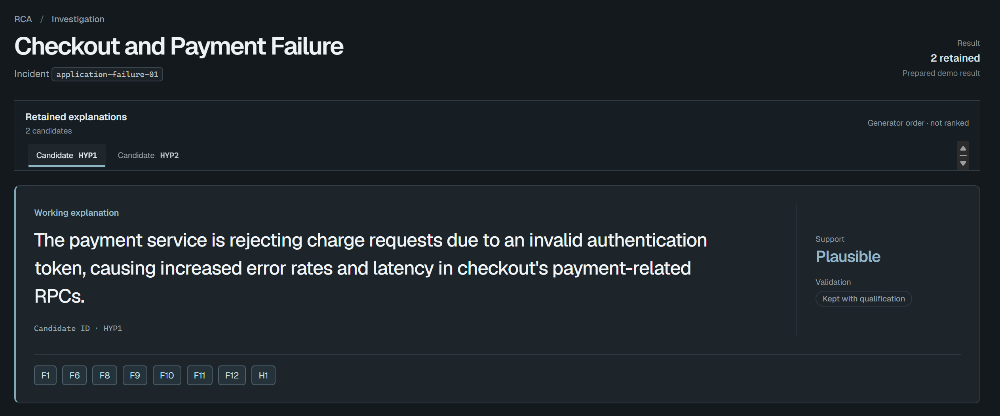

# RCA AI — Evidence-Grounded Incident Investigation Assistant

**RCA AI** is an AI-assisted incident investigation system that helps engineers explore potential root causes of failures in distributed applications.

Instead of attempting to produce a definitive root-cause diagnosis, RCA AI combines **retrieval-augmented reasoning, immutable incident evidence, and independent hypothesis validation** to generate traceable explanations that support human investigation.

The project focuses on building a practical, evidence-grounded reasoning pipeline under constrained LLM inference resources, with particular attention to **retrieval quality, provenance integrity, uncertainty, and validation**.

**[Live Demo](https://rca-ai-demo.duckdns.org/)** | **[Architecture](docs/architecture.md)** | **[Experiments](docs/experiments.md)** | **[Evaluation](docs/evaluation.md)**


## 1. Motivation

Root cause analysis (RCA) in distributed systems is challenging because incidents often affect multiple services and produce symptoms across different observability sources.

Metrics may reveal resource anomalies or error-rate changes. Logs can expose application-level failures, while distributed traces provide information about affected operations and service dependencies. Kubernetes events and states offer additional infrastructure context.

However, identifying the actual root cause requires more than collecting these signals.

Several challenges motivated this project:

- **Heterogeneous telemetry:** Metrics, logs, traces, and infrastructure events have different structures and diagnostic characteristics.
- **Evidence extraction:** Raw telemetry often contains noisy, redundant, or weakly relevant information. Filtering it can also remove critical diagnostic signals.
- **Limited inference resources:** Large telemetry contexts can exceed LLM token budgets or provider quotas.
- **Uncertain causality:** Observing correlated failures does not necessarily establish which component or mechanism caused the incident.
- **Unreliable explanations:** LLM-generated conclusions can overstate evidence, introduce unsupported assumptions, or confuse historical incidents with current observations.

Early experiments also showed that simply adding more telemetry to an LLM did not consistently improve root cause localization.

These observations motivated an architecture that separates **evidence preparation, retrieval, hypothesis generation, validation, and result assembly**, rather than relying on one LLM to interpret an entire raw telemetry payload.

## 2. Key Features

### Evidence-faithful Fact construction

RCA AI deterministically constructs immutable Facts from prepared incident evidence.

Each Fact preserves the observation's entity, field, value, and source reference. No LLM rewrites observations or infers causal relationships during Fact construction.

### Modality-specific historical retrieval

The retrieval subsystem uses separate BM25 ranking channels for:

- Metrics
- Logs
- Distributed traces
- Kubernetes observations

These rankings are combined using **Reciprocal Rank Fusion (RRF)** to retrieve relevant historical incidents.

Domain Knowledge is retrieved through a separate BM25-based path.

This design was informed by experiments showing that heterogeneous telemetry representations benefit from modality-aware retrieval rather than relying exclusively on one large mixed representation.

### Retrieval-augmented hypothesis generation

The LLM Generator uses current incident Facts alongside retrieved historical incidents and domain knowledge to propose one or more candidate explanations. Historical similarity offers investigation context but cannot establish the cause of a current incident.

### Independent hypothesis validation

Each generated hypothesis is evaluated independently.

The Validator examines its evidence basis, factual consistency, unsupported assumptions, causal overstatements, and potential contradictions.

Validation produces two separate assessments:

| Dimension | Possible values |
|---|---|
| Decision | `KEEP`, `KEEP_QUALIFIED`, `REJECT` |
| Support | `STRONG`, `PLAUSIBLE`, `WEAK`, `CONTRADICTED` |

A potentially useful hypothesis may be retained with explicit qualifications even when its causal mechanism has not been conclusively established.

### Explicit provenance and deterministic assembly

RCA AI maintains separate namespaces for:

| Namespace | Description |
|---|---|
| **F — Facts** | Evidence observed in the current incident |
| **H — History** | Historical incident precedents |
| **K — Knowledge** | General operational and domain knowledge |

Generated explanations and Validator commentary remain separate from observed Facts.

After validation, a deterministic Assembler produces the final RCA result without another LLM rewriting step. This preserves the validated wording, qualifications, and evidence references.

### Interactive investigation interface

A React-based frontend enables users to:

- Browse prepared incident scenarios.
- Review incident descriptions, symptoms, and evidence snapshots.
- Trigger RCA analysis.
- Explore competing hypotheses and their support levels.
- Inspect Validator qualifications and contradictions.
- Trace explanations back to current Facts, historical incidents, and domain knowledge.
- Review unresolved assumptions, investigation suggestions, and execution information.

## 3. System Architecture

At the system level, the React frontend connects through Caddy to FastAPI on a single EC2 instance. FastAPI invokes the official `RCAPipeline`, which uses Groq and Cerebras for its semantic stages.



*High-Level System Architecture — AWS EC2 runs the Caddy frontend and FastAPI backend; the RCA Core calls external AI providers.*

Within the backend, `RCAPipeline` begins with prepared canonical evidence and keeps Fact construction separate from retrieval before generating and validating hypotheses.



*RCA Core Execution Pipeline — source-linked Facts and retrieved context support hypothesis generation, independent validation, and deterministic result assembly.*

### Core design principles

The system follows several architectural principles:

**1. Preserve observations before reasoning.**  
Current incident Facts must remain source-faithful. Semantic inference belongs to the hypothesis layer.

**2. Separate responsibilities.**  
Retrieval identifies potentially relevant context, the Generator proposes explanations, and the Validator evaluates their support.

**3. Keep provenance explicit.**  
Historical incidents and domain knowledge must not be promoted into observations of the current incident.

**4. Represent uncertainty rather than hiding it.**  
A hypothesis can remain useful even when its causal mechanism is unverified, provided its limitations are clearly exposed.

**5. Prefer deterministic behavior where correctness can be checked structurally.**  
Fact construction, reference integrity, request-budget enforcement, and final assembly use deterministic code.

For component-level responsibilities and data contracts, see [Architecture](docs/architecture.md).

## 4. Live Demo

**[Open RCA AI Demo](https://rca-ai-demo.duckdns.org/)**

The deployed application provides an interactive interface for investigating prepared incident scenarios.



*Prepared scenario context and selected evidence are available before analysis begins.*



*The investigation view presents retained hypotheses with their support and validation status.*

### Available scenarios

The demo provides nine prepared incident scenarios covering application and infrastructure failures.

| Scenario | Status |
|---|---|
| Checkout and Payment Failure | Verified |
| Ad Service High CPU | Verified |
| Cart Storage Connection Failure | Verified |
| Payment Dependency Unavailable | Verified |
| Email Service Memory Growth | Verified |
| Order Messaging Slowdown | Verified |
| Telemetry Docs Startup Failure | Verified |
| Shipping Slowdown | Experimental |
| Container Restart Loop | Experimental |

Seven scenarios have accepted live end-to-end verification records.

The remaining two scenarios are available for experimentation but have not met the same acceptance criteria for investigative usefulness or reference integrity.

A successful execution demonstrates that the pipeline processed the prepared evidence and produced an accepted result under its validation rules. It does not establish that an AI-generated hypothesis is the confirmed root cause.

### Example investigation

Consider a Checkout and Payment Failure scenario.

The prepared evidence includes observations such as:

- Increased Checkout RPC errors.
- Failed Payment charge operations.
- Warning logs reporting invalid payment tokens.
- Missing successful payment completion messages.
- Changes in operation latency and error rates.

The Generator can propose a hypothesis connecting Payment authentication failures to Checkout errors.

The Validator then examines whether the proposed explanation is supported by current evidence, identifies any overstated causal relationships, and exposes unresolved assumptions.

The final interface presents the retained explanation alongside its supporting Facts, relevant historical context, and investigation suggestions.

This allows an engineer to examine both the proposed cause and the limitations of the available evidence.

## 5. Research and Experimental Findings

The architecture evolved through a series of controlled experiments, initially using the **RCAEval** dataset and later using telemetry captured from an instrumented OpenTelemetry Demo environment.

The initial research focused on root cause localization and compared metric-based baselines, retrieval methods, additional telemetry modalities, and LLM-assisted reasoning.

### Finding 1 — More telemetry does not always improve RCA

In the initial RCAEval experiments, metric-based representations provided useful incident signals.

Adding logs or traces through the tested extraction and representation methods did not consistently improve Top-1 root cause localization accuracy.

This does **not** establish that logs and traces are inherently less useful than metrics. Their diagnostic value depends on the incident, available signals, and the methods used to extract and represent information.

### Finding 2 — Historical retrieval improved the evaluated baseline

Controlled experiments showed that supplementing metric-based LLM reasoning with relevant historical incident context improved root cause localization.

One Phase 3 comparison reported:

| Approach | Top-1 Accuracy |
|---|---:|
| Metrics-only LLM | 60.23% |
| Metrics + Retrieval LLM | 70.11% |

Historical retrieval raised Top-1 root-cause service localization accuracy by approximately **9.88 percentage points** (60.23% → 70.11%) in this RCAEval Development experiment.

The experiment supported the use of historical retrieval as additional reasoning context rather than simply providing more raw telemetry.

### Finding 3 — Semantic reranking did not generalize consistently

An early experiment found that MiniLM reranking improved retrieval performance with compact metric-based incident representations.

However, later experiments using richer multimodal telemetry did not reproduce the same reliable benefit.

Longer-context reranking and alternative text representations also introduced trade-offs in ranking quality, complexity, and inference cost.

As a result, the final History retrieval design favors modality-specific BM25 with RRF over an additional semantic reranking stage.

### Finding 4 — Modality-specific retrieval provided a practical trade-off

In the later controlled retrieval experiments, splitting telemetry into modality-specific lexical views and combining rankings with RRF improved the observed ranking behavior compared with a mixed BM25 baseline.

The selected approach favors simple, deterministic retrieval and avoids additional model inference for reranking.

These results were obtained from a small controlled evaluation and do not establish universal superiority over semantic or hybrid retrieval methods.

### Research boundary

The original Colab experiments primarily evaluated root cause localization accuracy.

The current prepared RCA demo evaluates a different system behavior: evidence-linked hypothesis generation, validation, provenance integrity, and uncertainty handling.

**The research benchmark accuracy figures are not measurements of the current RCA Demo v1.**

See [Experiments](docs/experiments.md) for the experimental methodology, comparisons, and the engineering decisions they informed.

## 6. Getting Started

### Prerequisites

To run the local full-stack demo:

- Docker Engine and Docker Compose
- Groq API credentials
- Cerebras API credentials
- Network access to the configured LLM providers

### Run with Docker Compose

Create a local `.env` file using `.env.example` as the template.

Configure the two provider credentials:

```dotenv
GROQ_API_KEY=your_groq_api_key
CEREBRAS_API_KEY=your_cerebras_api_key
```

Do not commit credentials or other secrets to version control.

From the repository root, start the development stack:

```bash
docker compose up --build
```

Open the frontend:

**http://localhost:3000**

The FastAPI backend is available at:

**http://localhost:8000**

Browsing the prepared scenario catalog does not require an LLM request. Starting an analysis requires valid provider credentials.

Stop the containers with:

```bash
docker compose down
```

### Run a prepared scenario from the CLI

Python 3.12 is required.

Install the project:

```bash
python -m pip install -e .
```

Configure `GROQ_API_KEY` and `CEREBRAS_API_KEY` in the current process environment.

Then run an individual scenario:

```bash
python scripts/run_prepared_demo.py --scenario missing-secret-01
```

To run all nine prepared scenarios sequentially:

```bash
python scripts/run_prepared_demo.py --scenario all
```

Live execution may be affected by provider quotas, rate limits, or request-budget constraints.

### Run offline tests

Install the testing dependencies:

```bash
python -m pip install -e ".[test]"
```

Run the regression suite:

```bash
python -m pytest -q -p no:cacheprovider
```

The offline tests use fake providers and do not require live inference credentials.

## 7. Technology Stack

| Area | Technologies |
|---|---|
| RCA Core | Python, Pydantic |
| Historical retrieval | BM25, Reciprocal Rank Fusion |
| LLM inference | Groq, Cerebras |
| Backend API | FastAPI |
| Frontend | React, TypeScript, Vite |
| Containerization | Docker, Docker Compose |
| Testing | Pytest, frontend testing tools |
| Experimental environments | RCAEval, OpenTelemetry Demo, Google Colab |
| Infrastructure | AWS EC2, Terraform, GitHub Actions, Docker Hub, Caddy |

The prepared Demo v1 uses:

- **Generator:** Groq — `openai/gpt-oss-120b`
- **Validator:** Cerebras — `gpt-oss-120b`

These provider choices reflect the resource and operational constraints of the demo rather than a claim that they are the optimal models for all RCA workloads.

## 8. Scope and Limitations

RCA AI is a research-informed engineering prototype, not a production-ready autonomous RCA platform.

### Prepared incident evidence

The official demo operates on reviewed, schema-conformant canonical evidence.

Raw telemetry collection, source-specific connectors, and experimental preprocessing are outside the supported runtime analysis path.

The research environment used OpenTelemetry Demo deployments and fault-injection scripts to capture incident telemetry, but reliably transforming arbitrary raw telemetry into diagnostically useful evidence remains an unresolved problem.

### Preprocessing and information loss

Telemetry preprocessing involves a trade-off between deterministic processing and semantic interpretation.

Extensive rule-based filtering can increase implementation complexity and discard important signals. LLM-based summarization offers more flexibility but introduces additional inference cost, model dependence, and potential semantic distortion.

The current demo avoids claiming that this upstream problem has been solved.

### Prepared History and Knowledge

The system assumes access to curated historical incidents and relevant domain knowledge.

Building and continuously maintaining a reliable operational knowledge base, including human review of resolved incidents, is outside the current scope.

Retrieved information may be imperfectly relevant and must not be treated as proof of the current incident's root cause.

### Hypotheses rather than confirmed diagnoses

RCA AI generates candidate explanations with explicit support assessments and qualifications.

The Validator can identify unsupported assumptions, contradictions, and evidence-reference problems, but it does not guarantee complete semantic correctness.

The actual root cause must still be established through further investigation.

### Limited inference resources

The demo operates under constrained LLM inference resources.

A complete-request budget guard rejects requests exceeding the configured estimate rather than silently truncating or reducing immutable Facts.

Provider rate limits, model behavior, and context restrictions remain operational limitations.

### Evaluation and generalization

The prepared demo has accepted verification records for seven scenarios.

This demonstrates bounded end-to-end functionality but does not establish arbitrary incident support, production generalization, or improvements in operational metrics such as Mean Time to Resolution (MTTR).

See [Evaluation](docs/evaluation.md) for verified outcomes and known limitations.

## 9. Documentation

The repository documentation is organized around the system's most important architectural and experimental concerns.

| Document | Contents |
|---|---|
| [Architecture](docs/architecture.md) | System boundaries, component responsibilities, execution flow, and integration |
| [RCA Core Design](docs/core-design.md) | Immutable Facts, modality-specific retrieval, provenance, hypothesis generation, validation, and design trade-offs |
| [Experiments](docs/experiments.md) | RCAEval studies, benchmarks, ablations, retrieval evolution, and research findings |
| [Evaluation](docs/evaluation.md) | Prepared scenarios, live verification results, limitations, and reproducibility |

---

RCA AI is designed to **assist incident investigation, not replace engineering judgment**. Its central goal is to produce useful, evidence-grounded hypotheses while making their supporting observations, historical context, and remaining uncertainty visible.
