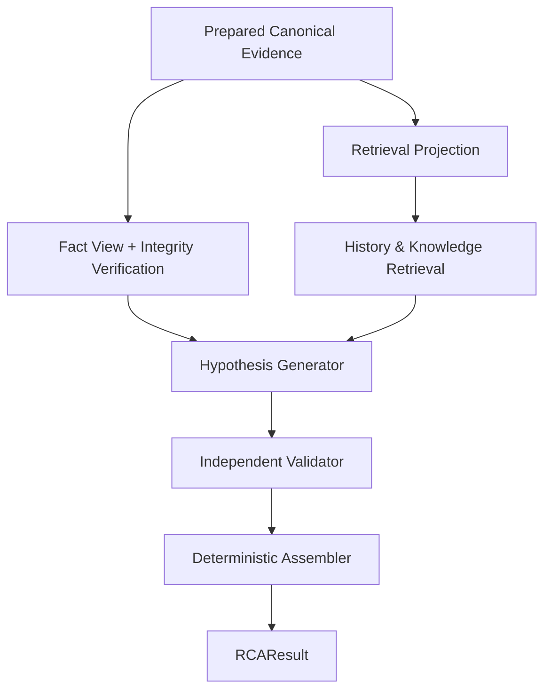

# System Architecture

RCA AI is an **evidence-grounded incident investigation assistant** for distributed systems.

It analyzes structured incident evidence, retrieves relevant historical and domain context, generates candidate explanations, and independently evaluates their evidential support.

The resulting investigation report preserves the distinction between observed facts, retrieved context, and AI-generated hypotheses.

RCA Demo v1 implements this workflow using a React frontend, a FastAPI backend, and a dedicated RCA Core.

The supported demo operates on reviewed, prepared incident evidence. It does not collect arbitrary live telemetry or autonomously modify the monitored infrastructure.

This document describes the implemented architecture, component boundaries, data flow, runtime execution, and deployment design.

For the reasoning and engineering decisions behind these components, see [Core Design](core-design.md).

---

## 1. Architecture Overview

The system is divided into three main layers:

1. **Presentation Layer:** A React interface for selecting incidents, initiating analyses, and exploring investigation results.
2. **Application Layer:** A FastAPI service responsible for scenario loading, analysis jobs, and API responses.
3. **RCA Core:** A structured investigation pipeline responsible for evidence processing, contextual retrieval, hypothesis generation, validation, and final result assembly.

The Core operates on canonical incident evidence and does not depend on the frontend or a particular deployment environment.

### 1.1. High-Level Architecture


*RCA Demo v1 at a glance. The browser accesses React through Caddy on EC2; FastAPI invokes the RCA Core over prepared evidence. The delivery workflow tests the application before building and publishing Docker images, then deploys through AWS Systems Manager. These delivery components are outside RCA reasoning.*

The figure combines the **runtime architecture** with its **AWS deployment environment**. Prepared incident, History, and Knowledge files are bundled in the backend image; EBS provides the EC2 root storage, not a separate application data volume. In the supported demo, analysis begins with prepared canonical evidence; telemetry collection and upstream preprocessing are not executed by the hosted RCA Core.

The application provides the user-facing workflow, while `RCAPipeline` remains the single supported orchestration path for incident analysis. The API does not implement a separate reasoning pipeline.

### 1.2. System Responsibilities

| Component | Responsibility |
|---|---|
| React Frontend | Scenario selection, incident overview, analysis execution, and result visualization |
| FastAPI | Scenario catalog, job management, analysis API, and result delivery |
| Prepared Evidence Registry | Load reviewed canonical incident inputs |
| Fact Builder | Construct immutable source-linked current Facts |
| Retrieval | Retrieve relevant historical incidents and Domain Knowledge |
| Hypothesis Generator | Propose possible explanations from available evidence and context |
| Independent Validator | Evaluate evidential support, contradictions, and qualifications |
| Deterministic Assembler | Construct the final structured `RCAResult` |
| External LLM Providers | Execute structured generation and validation requests |

---

## 2. Supported System Boundary

### 2.1. Prepared Evidence Instead of Raw Telemetry

Production observability platforms collect data from multiple sources, including:

- Prometheus for metrics.
- OpenSearch for logs.
- Jaeger for distributed traces.
- Kubernetes for workload state and events.

During earlier development, the project explored connecting to these sources and transforming their outputs into structured incident evidence.

However, the current public demo does not execute that acquisition and preprocessing workflow.

Its supported boundary begins after evidence preparation.

| Scope | Responsibility | Included in running Demo v1? |
|---|---|---|
| Upstream research / prototype | Collect telemetry from microservices and Kubernetes through Prometheus, OpenSearch, Jaeger, and Kubernetes APIs; run connectors and source adapters | No |
| Offline preparation | Transform and review observations as canonical incident evidence | Before runtime only |
| Supported RCA Core | Analyze prepared canonical evidence, retrieve context, generate and validate hypotheses, assemble `RCAResult` | Yes |
| Application and UI | Expose analysis through FastAPI and present results in React | Yes |

The distinction is important.

The demo demonstrates the investigation pipeline over structured evidence. It does not demonstrate an operational collector that continuously monitors arbitrary customer infrastructure.

### 2.2. Runtime Input Contract

The Core accepts an `IncidentInput` object containing:

- `incident_id`
- `evidence: CanonicalIncidentEvidence`

The canonical evidence contains an incident time window and ordered observations.

An observation includes:

| Field | Description |
|---|---|
| `observation_id` | Stable observation identifier |
| `signal` | Telemetry modality |
| `entity` | Explicit owner of the observation |
| `field` | Structural observation type |
| `value` | Modality-specific evidence content |
| `attributes` | Supporting structured attributes |
| `source` | Source identity and location information |

The Core does not accept raw Prometheus, OpenSearch, Jaeger, or Kubernetes responses as its public input contract.

It also does not require callers to construct a second retrieval-specific input.

Both the Fact View and Retrieval View are derived internally from the supplied canonical evidence.

### 2.3. Incident Time Window

A canonical incident defines three timestamps:

```json
{
  "baseline_start": 1790334483.0,
  "incident_start": 1790334581.0,
  "incident_end": 1790334701.0
}
```

These values are taken from the prepared `application-failure-01` fixture.

They distinguish:

- The beginning of the baseline observation period.
- The beginning of the incident period.
- The end of the incident observation period.

The timestamps are part of the prepared input.

The RCA Core does not independently recollect observations or construct new telemetry windows during analysis.

### 2.4. Reproducibility Boundary

The current demo is reproducible from its reviewed canonical inputs onward.

It does not reconstruct the original telemetry collection process.

This means that the project can test and verify the same structured inputs, but it cannot claim complete raw-to-diagnosis reproducibility from arbitrary external telemetry sources.

---

## 3. Prepared Incident Dataset

### 3.1. Scenario Registry

The repository contains nine prepared incident scenarios under:

```text
data/demo/
```

Each scenario is stored as canonical evidence.

The catalog contains seven verified demonstrations and two experimental scenarios.

| Scenario ID | Scenario | Observations | Status |
|---|---|---:|---|
| `application-failure-01` | Checkout and Payment Failure | 14 | Verified |
| `ad-high-cpu-01` | Ad Service High CPU | 13 | Verified |
| `cart-failure-01` | Cart Storage Connection Failure | 5 | Verified |
| `dependency-unavailable-01` | Payment Dependency Unavailable | 8 | Verified |
| `memory-leak-01` | Email Service Memory Growth | 5 | Verified |
| `messaging-failure-01` | Order Messaging Slowdown | 9 | Verified |
| `missing-secret-01` | Kubernetes Missing Secret | 5 | Verified |
| `crash-loop-backoff-01` | Container Restart Loop | 3 | Experimental |
| `downstream-latency-01` | Shipping Downstream Latency | 4 | Experimental |

The observation counts represent the **current prepared demo inputs**.

They are not interchangeable with counts from earlier, larger Processor captures or historical release-regression fixtures.

All nine inputs can be selected for analysis after passing catalog and manifest checks.

Verification status is a separate quality assessment, not a restriction on loading the scenario.

### 3.2. Evidence Modalities

The prepared scenarios cover four telemetry modalities:

| Signal | Typical Information |
|---|---|
| Metrics | Resource measurements, error counters, latency statistics, and changes between observation periods |
| Logs | Structured log patterns, severity, occurrence counts, and changes |
| Traces | Service operations, dependency relationships, errors, and latency |
| Kubernetes | Container states, workload conditions, restart information, and events |

Modality coverage differs by incident.

For example:

- `application-failure-01` contains metrics, logs, traces, and Kubernetes observations.
- `ad-high-cpu-01` also includes all four modalities.
- `missing-secret-01` contains only Kubernetes observations.
- `downstream-latency-01` mainly uses traces with Kubernetes context.

The RCA Core does not require every incident to contain all four modalities.

### 3.3. Evidence Selection and Manifest

Prepared inputs are curated subsets of earlier canonical captures.

Their selection is recorded in:

```text
data/demo/selection_manifest.json
```

The manifest records information such as:

- Source capture identity.
- Source artifact and digest.
- Included observation identifiers.
- Selection rationale.
- Known evidence gaps.

Each included canonical observation is copied from its source capture without rewriting its contents.

The prepared inputs do not combine evidence from unrelated captures or embed a generated diagnosis inside the canonical observation set.

This selection occurs **before** the runtime RCA Core receives the incident.

The Core itself does not select or discard current Facts to fit an inference request.

### 3.4. Scenario Metadata Is Not RCA Evidence

The web interface presents human-readable scenario information to help users understand each prepared incident.

This presentation metadata may include:

- Scenario title.
- Description.
- Known failure or injected cause.
- Symptoms.
- Investigation summary.

Such information is maintained separately from the Core input.

The analysis request identifies a prepared scenario, and the backend loads its canonical evidence.

**Presentation metadata, including a known cause, is not passed to the Hypothesis Generator or Validator as current incident evidence.**

This boundary prevents the demo from supplying the expected answer through its human-facing descriptions.

### 3.5. Known Dataset Limitations

The selected evidence may not contain every observation needed to establish the original causal mechanism.

Missing modalities or unselected observations can limit the conclusions that the Core can reasonably support.

The selection manifest records these gaps where known.

For further discussion of individual scenario outcomes, see [Evaluation](evaluation.md).


---

## 4. RCA Core Execution Pipeline

The official Core orchestration component is `RCAPipeline`.

It is responsible for executing a complete investigation from canonical input to final structured output.

The pipeline has five primary stages:

1. Fact construction and integrity verification.
2. Historical and Domain Knowledge retrieval.
3. Hypothesis generation.
4. Independent hypothesis validation.
5. Deterministic result assembly.

### 4.1. Core Data Flow



*Both views originate from the same canonical input. This simplified diagram omits direct side inputs to the Validator: at runtime, validation also receives the complete current Fact View and relevant retrieved History/Knowledge context.*

The Fact View and Retrieval View are independent deterministic projections of the same canonical input.

The Retrieval View does not replace the Fact View.

All current Facts remain available to the reasoning stages, regardless of whether a particular observation contributes to retrieval.

---

## 5. Fact Construction and Verification

### 5.1. Deterministic Projection

The Fact Builder converts each canonical observation into one source-linked Fact.

A Fact preserves:

- Fact identifier.
- Observed entity.
- Structural field.
- Original value.
- Source reference.
- Source path.

The Fact Builder does not use an LLM.

It does not infer causes, summarize observations into new claims, or reinterpret entity ownership.

### 5.2. Fact Integrity

Before reasoning, the pipeline verifies that the Fact View matches the supplied canonical evidence.

The supported contract requires:

- One Fact per canonical observation.
- Stable Fact ordering.
- Source-faithful values.
- Preserved entity ownership.
- Valid source references.
- Complete Fact forwarding.

All Facts produced from the input are passed to the Generator and to each Validator call.

There is no runtime Fact Selector in the supported pipeline.

### 5.3. Example

The prepared `missing-secret-01` scenario contains a Kubernetes observation describing a container in a waiting state with:

```text
container: telemetry-docs
container_state: waiting
waiting_reason: CreateContainerConfigError
```

Another observation records a Kubernetes event reporting that a named Secret was not found.

The Fact Builder preserves these observations separately.

It does not convert either one into a definitive statement about the root cause.

---

## 6. Retrieval Architecture

Retrieval provides contextual information to help the reasoning model investigate the incident.

The Core uses two separate retrieval mechanisms:

- Historical Incident Retrieval.
- Domain Knowledge Retrieval.

Neither produces current-incident Facts.

### 6.1. Historical Incident Store

The historical corpus contains 22 seeded incident records.

The records represent previously documented failure patterns, including their associated resolution context.

Historical retrieval answers:

> Which previously recorded incidents resemble the available observations?

A retrieved historical cause is a precedent, not an established explanation for the current incident.

### 6.2. Modality-Specific BM25

The Core constructs modality-specific lexical representations from canonical evidence.

Historical retrieval uses four BM25 channels:

The Retrieval View produces **four parallel lexical channels**, not a sequential chain:

| Channel | Search representation |
|---|---|
| Metrics BM25 | Metric names, labels, and change direction |
| Logs BM25 | Log patterns and severity |
| Traces BM25 | Service operations, errors, and dependency relationships |
| Kubernetes BM25 | Workload states and event reasons |

Each channel ranks historical candidates independently. **Reciprocal Rank Fusion (RRF)** merges the channel rankings, and the system selects up to three historical incidents for context.

Each modality independently ranks historical candidates using its own diagnostic terms.

The retrieval stage keeps bounded positive-scoring candidates per channel before fusion.

### 6.3. Reciprocal Rank Fusion

The channel rankings are combined using Reciprocal Rank Fusion (RRF).

The current configuration uses:

```text
RRF constant: k = 60
Final History candidates: Top-3
```

RRF combines ranking positions instead of requiring raw BM25 scores from different modalities to be directly comparable.

The final History context contains the selected historical sources and their identifying information.

### 6.4. Domain Knowledge Retrieval

Domain Knowledge is stored separately from historical incidents.

The prepared knowledge corpus currently contains three sourced Kubernetes knowledge entries.

Knowledge retrieval uses BM25 over structured knowledge keys and claims.

The Core supplies up to three positive-scoring knowledge entries as contextual information.

Knowledge retrieval uses the deterministic query material derived from canonical evidence.

### 6.5. Retrieval and Current Evidence

A retrieved incident may closely resemble the present failure.

A knowledge entry may explain a failure mechanism consistent with the observed symptoms.

However, neither is allowed to become a current-incident Fact.

That distinction is maintained explicitly in the provenance model.

The reasoning and trade-offs behind the retrieval design are described in [Core Design](core-design.md).


---

## 7. Provenance Model

The RCA Core uses separate namespaces to identify the origin and role of information.

| Namespace | Represents | Current Incident Evidence? |
|---|---|---|
| `F` | Source-linked current Facts | Yes |
| `H` | Historical incident context | No |
| `K` | General Domain Knowledge | No |
| Hypothesis | AI-generated explanation | No |
| Qualification | Validator assessment | No |

### 7.1. Information Flow

Current Facts establish what was observed.

History supplies examples of previously resolved incidents.

Knowledge supplies general operational semantics.

The Generator may use all three to propose explanations.

The Validator assesses whether the proposed explanations are sufficiently supported by the current evidence.

The final result retains the sources in their original categories.

### 7.2. Reference Integrity

The Generator and Validator produce structured references to the information they use.

The Assembler resolves these references against their corresponding stores.

Only current `F` references may populate the result's current evidence list.

Unknown or wrong-namespace references cause a contract failure rather than silently becoming accepted evidence.

The UI renders the referenced source information directly instead of reconstructing it through another LLM call.

---

## 8. Hypothesis Generation

The Hypothesis Generator receives:

- Complete current Facts.
- Retrieved History context.
- Retrieved Domain Knowledge.

It produces zero to three candidate hypotheses.

Each candidate may contain:

- An explanatory claim.
- Supporting or explained Fact references.
- Historical and Knowledge references.
- Assumptions.
- Unresolved questions.

The Generator may produce multiple competing explanations.

It may also abstain when it cannot propose a useful candidate.

### 8.1. Inference Provider

The supported Demo v1 configuration uses:

| Setting | Value |
|---|---|
| Provider | Groq |
| Model | `openai/gpt-oss-120b` |
| Temperature | 0 |
| Reasoning effort | Medium |
| Reasoning output included | No |
| Maximum completion tokens | 4096 |
| Output format | Strict JSON Schema |

The Generator is a candidate-generation component, not a causal proof engine.

Its statements remain hypotheses until evaluated independently.

---

## 9. Independent Hypothesis Validation

Each generated hypothesis is validated independently.

The Validator receives the candidate, relevant context, and the complete current Fact set.

It evaluates whether the hypothesis should be retained and which assumptions or explanatory claims require qualification.

### 9.1. Validation Dimensions

The Validator produces two separate assessments.

**Decision**

| Decision | Meaning |
|---|---|
| `KEEP` | Retain the hypothesis |
| `KEEP_QUALIFIED` | Retain with explicit qualifications |
| `REJECT` | Exclude the hypothesis |

**Support**

| Level | Meaning |
|---|---|
| `STRONG` | Substantial evidential support |
| `PLAUSIBLE` | Reasonable but incomplete support |
| `WEAK` | Limited support |
| `CONTRADICTED` | Material conflict with available evidence |

Decision and support are distinct output fields.

An unproven causal relationship does not automatically require rejection if the explanation remains useful and its uncertainty is clearly identified.

### 9.2. Validation Provider

The supported configuration uses:

| Setting | Value |
|---|---|
| Provider | Cerebras |
| Model | `gpt-oss-120b` |
| Execution | Independent structured validation per candidate |

The Validator is a separate inference stage.

It does not modify the original current Facts.

Its qualifications remain interpretive commentary.

### 9.3. Validation Outcomes

If the Generator returns zero hypotheses, the pipeline does not invoke the Validator.

If multiple hypotheses are generated, each is evaluated independently.

If all candidates are rejected, the resulting candidate list may be empty.

These are valid analytical outcomes.

They are distinct from provider or structured-output failures.

---

## 10. Deterministic Result Assembly

The final Assembler constructs the `RCAResult` from the Generator and Validator outputs.

It performs no LLM inference.

Its responsibilities include:

- Associating validation results with candidate identifiers.
- Excluding rejected candidates.
- Preserving the Generator's candidate order.
- Retaining validated hypothesis wording.
- Preserving assumptions and unresolved questions.
- Keeping Validator qualifications visible.
- Resolving F/H/K references from their original stores.
- Constructing the structured output required by the API and UI.

### 10.1. No Final LLM Rewrite

The pipeline intentionally does not use another LLM to rewrite the validated result.

This avoids introducing new unsupported claims or removing qualifications after validation.

### 10.2. Result Structure

A simplified final response is:

```json
{
  "incident_id": "example-incident",
  "candidate_results": [
    {
      "incident_id": "example-incident",
      "analysis": {
        "decision": "KEEP_QUALIFIED",
        "support_level": "PLAUSIBLE"
      },
      "hypothesis": {
        "id": "H1",
        "explanation": "A downstream dependency failure may be contributing to the observed errors.",
        "assumptions": [
          "The dependency failure occurred during the incident window."
        ],
        "unresolved": [
          "Confirm the downstream service state."
        ]
      },
      "evidence_refs": ["F1"],
      "history_refs": [],
      "knowledge_refs": [],
      "qualifications": [],
      "validation_unresolved": [
        "Inspect the downstream service logs."
      ]
    }
  ]
}
```

*Illustrative serialized shape, not a recorded output from a specific prepared scenario.*

The final result separates the candidate explanation from its evidence references and validation assessment.

The complete contract is described in [Core Design](core-design.md).

---

## 11. Request Budget and Provider Boundaries

LLM requests are subject to provider constraints and internal request-size limits.

The RCA Core includes `BudgetGuardProvider` to validate each complete request before transport.

### 11.1. Request Budget

The default local estimate is:

$$
T_{\mathrm{estimated}} =
\left\lceil
\frac{\text{serialized UTF-8 bytes}}{4}
\right\rceil
$$

The configured budget is:

```text
Default estimated input budget: 7,000 tokens
```

This is an internal estimate, not the provider's exact token count.

The guard does not guarantee that every accepted request will satisfy an external provider's quota.

### 11.2. Oversized Requests

If a complete Generator or Validator request exceeds the configured estimate:

- The request is rejected before provider transport.
- Current Facts are preserved.
- No automatic Fact truncation occurs.
- No runtime Fact reduction occurs.
- The failure is surfaced explicitly.

The application does not silently continue with a partial evidence set.

### 11.3. Provider Retry Behavior

Groq retains a bounded transport retry policy for configured transient failures, including rate limits, server errors, and transport problems.

The configured limit is three attempts in total.

Cerebras Validator calls do not add an automatic Core-level retry or fallback.

The Core does not perform semantic response repair or proactive inter-call pacing.

Exhausted provider failures remain execution failures rather than being converted into analytical abstentions.

### 11.4. Error Classification

| Situation | Interpretation |
|---|---|
| Zero hypotheses | Valid semantic abstention |
| All candidates rejected | Valid analytical outcome |
| Oversized complete request | Request-budget failure |
| Invalid structured response | Contract failure |
| Invalid evidence reference | Reference-integrity failure |
| Provider retries exhausted | Provider execution failure |

This separation ensures that the UI does not display a provider failure as though the system had concluded that the evidence was insufficient.

---

## 12. FastAPI Application Architecture

The application layer exposes the prepared scenarios and controls analysis execution.

It is implemented using FastAPI.

### 12.1. API Endpoints

| Method | Endpoint | Purpose |
|---|---|---|
| `GET` | `/api/demo/incidents` | Retrieve prepared incident catalog and overview data |
| `POST` | `/api/demo/analyses` | Start analysis of a selected prepared incident |
| `GET` | `/api/demo/analyses/{analysis_id}` | Poll job status and retrieve the final result |

The API does not accept arbitrary raw telemetry uploads.

The analysis endpoint receives a prepared scenario identifier.

For example:

```json
{
  "incident_id": "missing-secret-01"
}
```

The backend resolves the corresponding canonical evidence and invokes `RCAPipeline`.

### 12.2. Analysis Job Lifecycle

LLM-based analysis may require multiple sequential provider calls.

The API therefore uses an asynchronous job workflow rather than keeping the initial HTTP request open until reasoning completes.

| Step | Actor | Action / outcome |
|---|---|---|
| 1 | React → FastAPI | Request available incidents with `GET /api/demo/incidents` |
| 2 | React → FastAPI | Submit a prepared incident with `POST /api/demo/analyses` |
| 3 | FastAPI → React | Return `202 Accepted` and an `analysis_id` |
| 4 | FastAPI → `RCAPipeline` | Run the investigation using the prepared canonical input |
| 5 | RCA Core ↔ Providers | Generate candidate hypotheses and independently validate each candidate |
| 6 | RCA Core → FastAPI | Assemble `RCAResult` or return a structured execution failure |
| 7 | React → FastAPI | Poll `GET /api/demo/analyses/{analysis_id}` until complete or failed |
| 8 | React | Render the investigation result or execution error |

### 12.3. Job States

The application exposes four principal job states:

| State | Meaning |
|---|---|
| `queued` | Analysis has been accepted but has not started |
| `running` | RCA Core execution is in progress |
| `completed` | A valid assembled result is available |
| `failed` | Execution could not complete successfully |

The completed response includes the assembled result and source information needed by the frontend.

### 12.4. In-Memory Execution Model

The demo uses one in-process analysis worker.

Only one analysis job is executed at a time.

Concurrent analysis submissions are rejected with HTTP 409.

Job state is stored in memory.

Restarting the API process discards existing jobs.

This keeps the deployment simple for a bounded demonstration, but it does not provide distributed job execution, persistent queues, or durable analysis history.

---

## 13. React Frontend Architecture

The frontend provides an interactive investigation interface over the prepared scenario catalog.

It is built with React and TypeScript.

### 13.1. Scenario Overview

The user first selects one of the prepared scenarios.

The interface displays an overview containing available evidence signals and human-readable incident context.

The overview can be loaded without invoking an LLM.

This allows users to inspect the scenario before starting an analysis.


*The known scenario cause is human-facing demo metadata only; it is not supplied to the Generator or Validator as incident evidence. The Core receives the prepared canonical observations instead.*

### 13.2. Analysis Workflow

When the user starts an analysis, the frontend:

1. Submits the selected scenario identifier.
2. Receives an analysis job identifier.
3. Polls the API for status updates.
4. Displays a running state while the Core executes.
5. Renders the completed investigation or a visible execution failure.

The frontend discards stale responses after the user switches incidents.

This prevents a result belonging to a previous incident from appearing under a newly selected scenario.

### 13.3. Investigation Result

The result interface presents:

- Candidate hypotheses.
- Validation decisions.
- Support levels.
- Current evidence references.
- Historical and Knowledge references.
- Qualifications.
- Assumptions and unresolved questions.

Evidence is rendered from the original source-linked data.

The frontend does not request another LLM-generated summary to reconstruct current Facts.


*One of two retained candidates is shown with plausible support and a qualified validation. The F references point to current Facts; H1 points to historical context. The explanation is not a confirmed root cause.*

### 13.4. Error Presentation

Backend failures are displayed separately from valid results with no retained candidates.

The UI can provide a manual retry path for exhausted rate-limit failures.

It does not automatically rerun an analysis after a contract or semantic validation failure.

---

## 14. Deployment Architecture

The demo supports local execution and a simplified cloud deployment design.

### 14.1. Local Development

The development environment consists of:

- React/Vite frontend.
- FastAPI backend.
- Local prepared JSON fixtures.
- Historical and Knowledge stores.
- External Groq and Cerebras inference APIs.

Docker Compose can start the frontend and backend locally.

The Vite development server proxies `/api` requests to FastAPI.

The local interface is available at:

```text
http://localhost:3000
```

The backend is exposed locally at:

```text
http://localhost:8000
```

### 14.2. AWS Deployment Design

The documented AWS deployment uses a single EC2 instance.

Docker Compose runs the frontend proxy and backend services.

Caddy serves the React application over HTTPS and routes API requests to FastAPI.

The backend is not intended to be publicly exposed directly.

The AWS runtime and delivery topology are shown in the **High-Level Architecture** figure in §1.1. Its runtime path is browser → Caddy (HTTPS) → React / FastAPI → RCA Core, with outbound requests to Groq and Cerebras. Prepared evidence and contextual stores are hosted with the application.

The design favors a low-complexity deployment suitable for a portfolio demonstration rather than a production-grade, highly available service.

### 14.3. Infrastructure and Delivery

The deployment guide documents:

- Terraform for provisioning AWS infrastructure.
- EC2 and its associated storage and networking configuration.
- AWS Systems Manager for controlled host management and deployment.
- AWS Parameter Store for provider API credentials.
- GitHub Actions for tests and image publication.
- Docker Hub for frontend and backend images.
- Caddy for HTTPS termination and reverse proxying.
- DuckDNS for a public hostname.

The delivery workflow is designed around publishing immutable container images and deploying exact image digests.

For the AWS topology and image-delivery workflow, refer to the architecture figure in §1.1.

The documented infrastructure and delivery workflow are deployment components; they are not additional RCA reasoning stages.

Refer to the [AWS Deployment Guide](deployment/manual-setup.md) for operational setup and configuration.

### 14.4. Deployment Limitations

The single-instance design intentionally avoids:

- Kubernetes-based application orchestration.
- Multi-region deployment.
- High-availability replicas.
- Distributed job queues.
- Durable analysis persistence.

Application jobs are maintained in memory and do not survive backend restarts.

The system depends on outbound network access to its inference providers.

---

## 15. Execution and Reproducibility

### 15.1. Running the Prepared Demo

The repository includes a standalone CLI runner.

To analyze one scenario:

```bash
python scripts/run_prepared_demo.py --scenario missing-secret-01
```

To run the full scenario catalog sequentially:

```bash
python scripts/run_prepared_demo.py --scenario all
```

The runner invokes the same official `RCAPipeline` used by the API.

The full catalog includes experimental scenarios, so a successful nine-scenario live run is not guaranteed.

The runner stops and reports a failure if a scenario cannot complete.

### 15.2. Repository Structure

The relevant project layout is:

```text
.
├── data/
│   ├── demo/
│   │   ├── selection_manifest.json
│   │   └── <prepared-incident>.json
│   ├── history/
│   └── knowledge/
│
├── src/
│   └── rca_ai/
│       ├── api/
│       ├── domain/
│       ├── facts/
│       ├── retrieval/
│       ├── pipeline/
│       └── ...
│
├── frontend/
├── scripts/
│   └── run_prepared_demo.py
│
├── tests/
├── infra/
│   └── terraform/
│
└── docs/
    ├── architecture.md
    ├── core-design.md
    ├── experiments.md
    └── evaluation.md
```

*Simplified layout showing major responsibilities rather than every package and configuration file.*

### 15.3. Offline Verification

Offline regression tests use fake inference providers.

They verify deterministic components and request contracts without requiring external model access.

The test suite covers areas such as:

- Fact projection.
- Source integrity.
- Retrieval behavior.
- Structured model contracts.
- Provider errors.
- Request-budget enforcement.
- Result assembly.
- Prepared scenario loading.
- API and UI behavior.

The recorded verification outcomes are documented in [Evaluation](evaluation.md).

### 15.4. Live Verification

Live verification exercises Groq and Cerebras using the prepared scenarios.

The saved verification records contain seven accepted end-to-end outcomes.

Two scenarios remain experimental:

- `crash-loop-backoff-01`: Valid execution, but insufficiently useful speculative explanations.
- `downstream-latency-01`: Validator reference-integrity failure during a recorded execution.

Their limitations remain visible rather than being hidden or automatically corrected.

---

## 16. Architectural Boundaries and Limitations

The current architecture deliberately limits the scope of the demo.

| Area | Supported Scope | Limitation |
|---|---|---|
| Incident input | Reviewed canonical evidence | No arbitrary raw telemetry ingestion |
| Fact construction | Complete deterministic projection | Depends on upstream evidence quality |
| Retrieval | Prepared History and Domain Knowledge | Small seeded corpora |
| Reasoning | Candidate hypothesis generation | No guarantee of correct root cause |
| Validation | Structured independent assessment | Cannot guarantee complete semantic correctness |
| Request handling | Bounded complete requests | Oversized inputs fail |
| Analysis execution | One in-process worker | No distributed processing |
| Persistence | In-memory job state | Jobs lost after backend restart |
| Deployment | Single EC2 design | No high availability |
| Evaluation | Nine prepared scenarios | No proven production generalization |

These are explicit boundaries of the current implementation.

They are not claims that broader capabilities have already been implemented.

The system does not autonomously remediate incidents or modify customer infrastructure.

---

## 17. Architecture Summary

RCA AI separates the investigation workflow into three layers.

**Presentation and application**

React and FastAPI provide scenario selection, background analysis execution, and structured result visualization.

**Deterministic evidence and retrieval processing**

The RCA Core constructs complete source-faithful Facts and retrieves History and Domain Knowledge without promoting contextual information into current evidence.

**Semantic investigation**

The Generator proposes possible explanations, the independent Validator evaluates and qualifies them, and the deterministic Assembler constructs the final result.

This separation allows the system to preserve observations while still using LLMs for uncertain causal reasoning.

The resulting architecture aims to make incident investigations more transparent and traceable without presenting generated hypotheses as automatically confirmed root causes.

---

## Further Reading

- [Core Design](core-design.md) — Engineering decisions, invariants, and trade-offs.
- [Experiments & Research Findings](experiments.md) — Research questions and RCAEval results.
- [Evaluation](evaluation.md) — Prepared-scenario verification and limitations.
- [Project README](../README.md) — Project overview and getting started.
