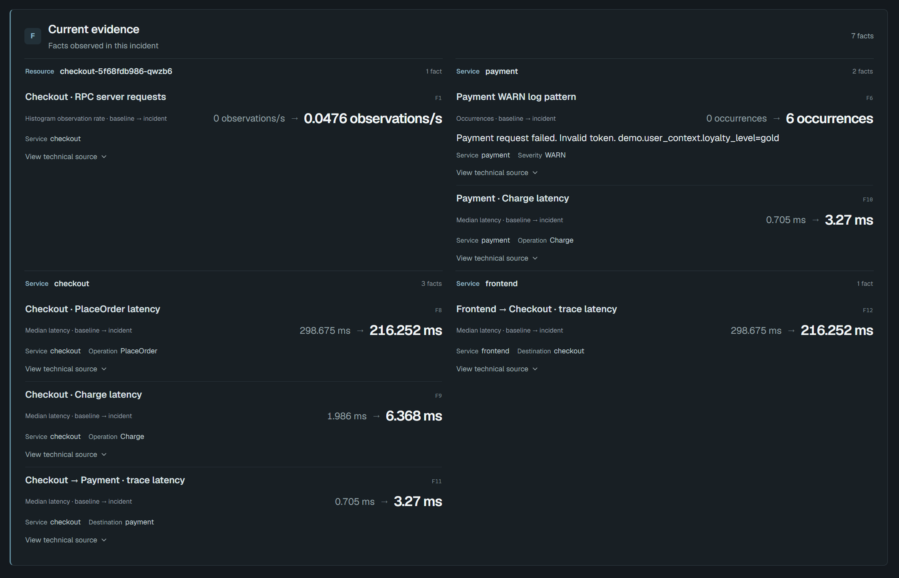
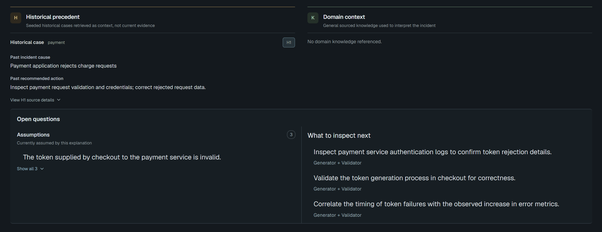
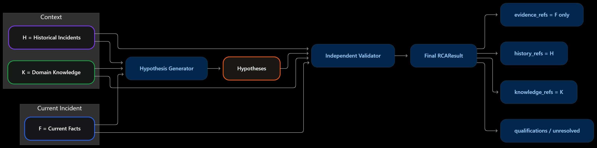
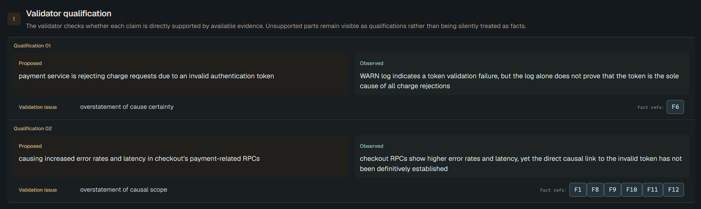

# RCA Core — Design Decisions

RCA AI is an **evidence-grounded incident investigation assistant** designed to help engineers understand failures in distributed systems.

Rather than forcing a single definitive root cause, the system constructs source-linked observations, retrieves relevant historical and domain context, generates candidate explanations, and independently evaluates their evidential support.

The RCA Core is designed around one central principle:

**Observed evidence must remain distinguishable from retrieved context and generated inference throughout the investigation.**

This document explains the engineering decisions behind the current RCA Core, why they were made, and the trade-offs they introduce.

For the overall system architecture, see [System Architecture](architecture.md). For the experiments motivating some of these decisions, see [Experiments & Research Findings](experiments.md).

---

## 1. Design Objectives

Building an LLM-based RCA system involves more than supplying telemetry to a language model.

Distributed system incidents frequently contain overlapping symptoms, incomplete observations, and ambiguous relationships between services.

For example, increased Checkout errors may coincide with failed Payment operations. This correlation suggests a possible dependency-related problem, but it does not independently establish which component originated the failure or why.

A useful investigation assistant must therefore preserve the distinction between:

- **Observations:** What the monitoring evidence actually reports.
- **Context:** What previous incidents or operational knowledge suggest.
- **Hypotheses:** What may explain the current incident.
- **Validation:** Which explanations are worth retaining and what remains uncertain.

The RCA Core prioritizes five objectives.

| Objective | Design Requirement |
|---|---|
| Evidence integrity | Preserve source-linked observations without semantic rewriting |
| Traceability | Keep current evidence, historical precedents, and general knowledge distinguishable |
| Grounded reasoning | Require hypotheses to reference the information used to support them |
| Explicit uncertainty | Allow useful but unproven explanations to remain qualified |
| Predictable execution | Enforce output contracts, request budgets, and final assembly deterministically |

The architecture intentionally separates deterministic processing from semantic reasoning.


---

## 2. The Canonical Evidence Boundary

### 2.1. Why Define a Strict Input Contract?

Observability data comes from heterogeneous sources.

Metrics contain numerical measurements, logs contain event messages, traces represent operations and dependencies, and Kubernetes exposes workload states and events.

These formats differ substantially in structure and meaning.

If the RCA Core directly interpreted arbitrary source-specific payloads, evidence processing and causal reasoning would become tightly coupled.

This would make it harder to distinguish errors in telemetry preparation from errors in the reasoning pipeline.

The system therefore defines a canonical input boundary.

### 2.2. Supported Input

The RCA Core receives an `IncidentInput` containing:

- `incident_id`: the identifier of the current incident.
- `evidence`: a `CanonicalIncidentEvidence` object.

The evidence contains a time window and ordered canonical observations.

A canonical observation includes:

| Field | Purpose |
|---|---|
| `observation_id` | Stable identity of the observation |
| `signal` | Metric, log, trace, or Kubernetes |
| `entity` | The observed service, resource, container, or event |
| `field` | Structural observation type |
| `value` | Modality-specific observation data |
| `attributes` | Additional structured attributes |
| `source` | Origin and provenance information |

For example, the prepared `missing-secret-01` scenario includes a Kubernetes observation containing:

```json
{
  "signal": "kubernetes",
  "entity": {
    "type": "container",
    "id": "telemetry-docs"
  },
  "field": "kubernetes.structural.state",
  "value": {
    "lane": "kubernetes.structural.state",
    "container": "telemetry-docs",
    "container_state": "waiting",
    "waiting_reason": "CreateContainerConfigError"
  }
}
```

*Abbreviated for readability. The actual canonical observation includes its identifier, additional value fields, attributes, and source provenance.*

The observation describes a container state. It does not independently explain the underlying cause.

### 2.3. Separation from Telemetry Processing

The supported Demo v1 starts from prepared canonical evidence.

Raw telemetry acquisition, source adapters, and general-purpose preprocessing are upstream responsibilities outside the running RCA Core.

During development, evidence preparation was explored using Prometheus, OpenSearch, Jaeger, and Kubernetes telemetry.

However, the public demo does not claim to accept arbitrary raw payloads from those systems.

The supported execution boundary is:

```text
Prepared Canonical Evidence
           |
           v
        RCA Core
           |
           v
        RCAResult
```

This boundary allows the Core to focus on investigation semantics rather than source-specific parsing.

**Trade-off:** The Core becomes easier to test and reason about, but its diagnostic completeness depends on the evidence supplied upstream.

---

## 3. Decision 1 — Preserve Current Evidence as Immutable Facts

### 3.1. The Problem with Early Semantic Summarization

LLMs are effective at turning complex observations into readable explanations.

However, using an LLM to summarize evidence before reasoning introduces a significant risk: the summary may contain interpretations that are stronger than the original observations.

Consider the following statement:

> Payment Charge errors increased during the incident window.

This is an observation.

A model might summarize it as:

> Payment authentication is failing.

A later reasoning stage might further strengthen that statement:

> Invalid credentials caused the Checkout outage.

Each transformation introduces additional assumptions.

If the intermediate statements are treated as evidence, subsequent stages may reason over model-generated interpretations instead of the original observations.

### 3.2. Deterministic Fact Construction

The RCA Core uses a deterministic Fact Builder.

Each canonical observation is projected into exactly one source-linked Fact.

A Fact contains:

| Field | Description |
|---|---|
| `fact_id` | Stable identifier within the current Fact View |
| `entity` | Explicitly observed entity |
| `field` | Original structural field |
| `value` | Source-faithful value |
| `source_ref` | Identity of the source record |
| `source_path` | Location of the observation within its source |

The Fact Builder does not use an LLM.

It preserves the input's entity ownership and structured value rather than inferring additional relationships.

For example, if a Kubernetes event reports:

```text
Error: secret "eda-capture-secret-does-not-exist" not found
```

the Fact View preserves the reported event.

It does not transform that message into a confirmed claim that a particular deployment configuration is the sole cause of the failure.

### 3.3. Fact Integrity Invariants

The current implementation enforces several invariants:

1. Every supplied canonical observation is represented in the Fact View.
2. Fact construction is deterministic.
3. Fact values are preserved without semantic paraphrasing.
4. Entity ownership and source references are not inferred or broadened by the Fact Builder.
5. Generated hypotheses cannot introduce new current Facts.

`RCAPipeline` independently verifies the Fact projection before proceeding.

The same complete Fact set is subsequently supplied to the Generator and each independent Validator call.



*The interface presents current Facts and lets investigators inspect their technical source details.*

### 3.4. Why This Decision Matters

The Fact View provides a stable boundary between evidence and inference.

A model is free to propose what an observation might mean, but it cannot silently redefine what was observed.

This also improves debugging.

If an investigation produces an incorrect explanation, engineers can inspect whether the problem originated from incomplete evidence, retrieval context, model reasoning, or validation.

**Decision:** Preserve current incident observations deterministically and allow semantic interpretation only in explicitly identified reasoning stages.


---

## 4. Decision 2 — Separate Fact View from Retrieval View

### 4.1. Different Stages Need Different Representations

The same canonical evidence serves two purposes.

First, it provides trustworthy observations for hypothesis generation and validation.

Second, it provides search terms for retrieving relevant historical incidents and operational knowledge.

These tasks require different representations.

A source-faithful representation may contain detailed statistical measurements, resource labels, uncertainty indicators, and source paths.

Many of these fields are important for accurate interpretation but contribute little to lexical retrieval.

Conversely, retrieval benefits from emphasizing service names, error labels, operation identities, and change directions.

Using one representation for both purposes creates unnecessary trade-offs.

### 4.2. Fact View

The Fact View prioritizes fidelity.

It preserves the canonical observation's structured content and provenance.

For example, a metric Fact may retain:

- Metric identity.
- Baseline and incident measurements.
- Change direction.
- Sample counts.
- Resource labels.
- Uncertainty indicators.
- Source location.

This is the representation used to establish what the current incident evidence reports.

### 4.3. Retrieval View

The Retrieval View is a deterministic projection optimized for matching historical records.

It emphasizes diagnostically relevant terms associated with each modality.

Examples include:

```text
Metric:
service=payment
metric=rpc_client_call_duration_seconds_count
status=UNAVAILABLE

Log:
service=cart
pattern="Wasn't able to connect to redis"

Trace:
service=checkout
callee=payment
error=increased

Kubernetes:
container=telemetry-docs
waiting_reason=CreateContainerConfigError
```

*Illustrative lexical representations, not exact serialized output from the runtime.*

The retrieval projection does not replace the Fact View.

Information omitted from a retrieval query remains available as current evidence.

### 4.4. Retrieval Eligibility Is Not Evidence Validity

Some observations may be valid current Facts but poor retrieval signals.

For example, a log such as:

```text
High CPU-Load problempattern enabled
```

may describe a testing or fault-injection state.

It is still an observed log pattern and can remain in the Fact View.

However, using such a statement as a historical search term can produce misleading matches based on experimental narration rather than application symptoms.

The current retrieval projection includes a deterministic rule for excluding explicit control or problem-pattern narration from search.

This rule affects retrieval participation only.

It does not delete the observation, modify its value, or change its provenance.

### 4.5. Trade-off

Separating the two views introduces additional deterministic processing.

However, it avoids compromising evidence integrity merely to improve search relevance.

**Decision:** Maintain a complete, source-faithful Fact View and an independently constructed Retrieval View.


---

## 5. Decision 3 — Use Modality-Specific Retrieval for Historical Context

### 5.1. Why Historical Retrieval?

Earlier RCAEval experiments showed that retrieved historical incidents could improve root-cause service localization in a compact metric-based setting.

This motivated retaining historical retrieval as a source of contextual information.

However, retrieval has a limited responsibility.

It identifies previous incidents that may be relevant to the current symptoms.

It does not determine the current incident's cause.

A highly ranked historical case may provide a useful precedent even when its recorded root cause does not apply to the present failure.

### 5.2. Multimodal Retrieval Design

The current RCA Core supports canonical observations from four modalities:

- Metrics.
- Logs.
- Traces.
- Kubernetes.

These modalities have different diagnostic vocabularies.

Metrics emphasize measurements, labels, and change directions.

Logs emphasize message patterns and severity.

Traces emphasize operations, service relationships, errors, and latency.

Kubernetes observations emphasize workload states, restart conditions, and event reasons.

Combining all of them into one undifferentiated lexical representation can create ranking interference.

The current retrieval design therefore uses four modality-specific BM25 channels.

```text
Current Canonical Evidence
             |
     Retrieval Projection
             |
    +--------+--------+--------+--------+
    |        |        |        |        |
    v        v        v        v        v
 Metrics   Logs     Traces   Kubernetes
  BM25     BM25      BM25      BM25
    |        |         |         |
    +--------+---------+---------+
                      |
                      v
             Reciprocal Rank Fusion
                      |
                      v
              Top-3 Historical
                  Incidents
```

### 5.3. BM25 Channels

Each channel independently ranks historical candidates using the corresponding modality representation.

A modality can contain multiple structural fields.

For example:

| Modality | Example Canonical Fields |
|---|---|
| Metric | `metric.structural.series`, `metric.structural.histogram_mean` |
| Log | `log.structural.pattern` |
| Trace | `trace.structural.operation`, `trace.structural.edge`, `trace.structural.boundary` |
| Kubernetes | `kubernetes.structural.state`, `kubernetes.structural.event` |

These fields describe different observation types within a modality.

They are not separate BM25 indexes for every structural field.

### 5.4. Reciprocal Rank Fusion

After the independent BM25 rankings are produced, the system combines them using Reciprocal Rank Fusion (RRF).

For historical candidate $d$:

$$
\operatorname{RRF}(d)=
\sum_{m\in M_d}
\frac{1}{k+\operatorname{rank}_m(d)}
$$

where:

- $M_d$ contains the channels in which candidate $d$ appears.
- $\operatorname{rank}_m(d)$ is its position in channel $m$.
- $k=60$ is the configured fusion constant.

RRF combines ranking positions rather than comparing raw BM25 scores across modalities.

The final retrieval stage returns up to three historical incidents.

### 5.5. Why Not Keep MiniLM?

The earlier RCAEval research demonstrated that MiniLM reranking improved historical retrieval and downstream localization for compact metric-token representations.

However, a subsequent **Multimodal Retrieval Design Study** found that the same benefit did not transfer reliably to richer telemetry representations.

The evaluated alternatives included mixed lexical retrieval, semantic reranking, representation normalization, and modality-specific retrieval.

The study used a small seeded corpus, so its results do not establish universal superiority.

Nevertheless, it provided enough engineering evidence to choose a simpler retrieval configuration for the bounded demo.

The current runtime therefore omits MiniLM and uses modality-specific BM25 with RRF.

This avoids maintaining an additional reranking inference stage without a demonstrated benefit under the evaluated multimodal setup.

The experimental comparisons and their limitations are documented in [Experiments](experiments.md).

### 5.6. Known Retrieval Trade-offs

The selected approach has limitations.

**Lexical dependence**

BM25 may miss semantically related incidents whose descriptions use different terminology.

**Modality coverage bias**

RRF can favor candidates appearing across several channels, even when another candidate has a stronger match in only one highly diagnostic modality.

**Corpus dependence**

Retrieval quality depends on the size, relevance, and representation of the historical collection.

The current historical corpus contains 22 prepared records across nine incident classes.

These are seeded reference records for a controlled demo, not an automatically accumulated production incident history.

**Decision:** Use deterministic, modality-specific BM25 with RRF as a practical historical candidate-selection mechanism, while leaving causal interpretation to the reasoning stages.


---

## 6. Decision 4 — Keep Historical Incidents and Domain Knowledge Separate

The retrieval subsystem contains two information stores.

They serve different purposes and should not be treated as interchangeable.

### 6.1. Historical Incidents

A historical incident describes a previously recorded failure pattern and its resolution context.

The historical corpus includes information such as:

- Affected components.
- Retrieval-oriented incident descriptions.
- Recorded root causes.
- Recommended actions.
- Resolution notes.

Historical incidents answer:

> Has something similar happened before?

They do not establish that the same root cause is present now.

### 6.2. Domain Knowledge

Domain Knowledge provides general operational information about technologies and failure mechanisms.

For example, sourced Kubernetes knowledge can explain how required Secrets affect container startup.

The current prepared knowledge collection contains three sourced Kubernetes entries.

Each entry includes a knowledge key, claim, and source information.

Domain Knowledge answers:

> What general behavior or technical rule may help interpret this observation?

It does not establish that the behavior has occurred in the current incident.

### 6.3. Domain Knowledge Retrieval

Knowledge retrieval is separate from History retrieval.

It uses BM25 over the knowledge key and claim fields, using the deterministic query material generated from the current canonical evidence.

The current design returns up to three positive-scoring knowledge entries.

Historical ranking uses modality-specific BM25 and RRF.

Knowledge ranking uses its own BM25 path.

### 6.4. Why the Separation Matters

Suppose a current Kubernetes event reports:

```text
Error: secret "eda-capture-secret-does-not-exist" not found
```

A historical incident might describe a similar startup failure caused by an unavailable Secret.

A Domain Knowledge entry might explain that a required Secret must be available before a dependent container can start.

Both can support investigation.

However:

- The Kubernetes event is a current observation.
- The historical incident is an analogy.
- The knowledge entry provides general operational semantics.

They have different evidential roles.



*The result keeps historical cases and sourced domain context in distinct sections.*

**Decision:** Retrieve historical precedents and sourced knowledge independently, and preserve their identities through reasoning and final output.

---

## 7. Decision 5 — Enforce Explicit Provenance Boundaries

### 7.1. The F/H/K Model

RCA AI represents information through separate provenance namespaces.

| Namespace | Meaning | Can Become Current Evidence? |
|---|---|---|
| `F` | Current incident Fact | Yes |
| `H` | Retrieved historical incident | No |
| `K` | Retrieved Domain Knowledge | No |
| Hypothesis | Generated explanation | No |
| Qualification | Validator assessment | No |



*Historical and domain context can inform hypotheses, while only current Facts populate current evidence references.*

This distinction forms a trust boundary around the reasoning pipeline.

Only original current Facts may populate the result's current-incident evidence.

Historical causes, general knowledge, and generated explanations remain separate.

### 7.2. Preventing Context Promotion

Retrieval-augmented reasoning introduces a common risk.

If a historical incident is highly similar to the current incident, an LLM may present its recorded root cause as though the same cause had been directly observed.

For example:

```text
Historical Incident:
A Payment outage was caused by expired credentials.

Current Incident:
Payment Charge errors increased.
```

The historical case may justify checking credentials.

It does not establish that the current Payment service has expired credentials.

A hypothesis may propose the possibility, but it must remain an inference unless supported by current observations.

### 7.3. Reference Integrity

The Generator can reference current Facts, retrieved historical incidents, and knowledge entries.

The Validator also uses references to explain which current observations support or contradict a candidate.

The final Assembler resolves each reference within its correct namespace.

Unknown or wrong-namespace references cause a contract failure rather than being silently accepted.

The UI should render referenced information from the original source stores instead of relying on reconstructed LLM descriptions.

### 7.4. Structural Validity Is Not Semantic Groundedness

A reference can be structurally valid while the claim it supports remains semantically weak.

For example, a candidate might cite a valid Fact describing increased Payment errors and claim that network congestion caused those errors.

The Fact reference exists.

However, the evidence may not contain any measurement of network congestion.

Structural validation verifies the reference.

Semantic validation must assess whether the causal explanation exceeds the available evidence.

These are complementary checks.

**Decision:** Enforce source identity deterministically while evaluating the strength of explanatory claims separately.

---

## 8. Decision 6 — Generate Hypotheses Instead of Forcing a Diagnosis

### 8.1. Why a Single Diagnosis Can Be Misleading

A distributed-system incident may support several explanations.

For example, Checkout errors might be associated with:

- Payment application failures.
- An unavailable downstream dependency.
- Resource contention.
- Network problems.
- Retry or timeout behavior.

The available evidence may establish symptoms without distinguishing all candidate causes.

Forcing one definitive answer can hide uncertainty or competing mechanisms.

### 8.2. Hypothesis Generator

The Generator receives:

- The complete current Fact set.
- Retrieved historical context.
- Retrieved Domain Knowledge.

It proposes zero to three candidate hypotheses.

Each candidate can contain:

- A hypothesis identifier.
- An explanatory claim.
- References to current Facts.
- References to historical incidents and knowledge.
- Assumptions.
- Unresolved investigation questions.

The Generator is not responsible for producing final proof.

It may propose uncertain explanatory relationships, provided they are identified as hypotheses rather than observations.

### 8.3. Multiple Candidates and Abstention

The Generator can return competing explanations.

It can also return no candidates when it cannot propose a meaningful hypothesis.

A zero-candidate result is a valid analytical outcome.

It should not be confused with a provider or validation failure.

This makes the reasoning model more suitable for incomplete evidence.

### 8.4. Generator Boundaries

The Generator must not:

- Invent current Facts.
- Modify source observations.
- Promote historical causes into current evidence.
- Assert general knowledge as an observed incident event.
- Select its own final confirmed diagnosis.
- Validate or silently repair its own output.

Its responsibility is to propose possible explanations for independent evaluation.

**Decision:** Treat causal explanations as explicitly uncertain investigation candidates, not authoritative root-cause declarations.

---

## 9. Decision 7 — Validate Hypotheses Independently

### 9.1. Why Separate Generation and Validation?

The Generator is optimized to construct plausible explanations.

A coherent explanation can still overstate causal relationships or overlook contradictory observations.

RCA AI therefore uses an independent Validator to evaluate each candidate.

Each generated hypothesis receives its own structured validation request.

The Validator uses the complete current Fact set and the relevant contextual references.

### 9.2. Two Independent Assessment Dimensions

Validation reports a **decision** and a **support level**.

#### Decision

| Decision | Meaning |
|---|---|
| `KEEP` | Retain the candidate |
| `KEEP_QUALIFIED` | Retain with explicit qualifications |
| `REJECT` | Exclude the candidate |

#### Support Level

| Support | Meaning |
|---|---|
| `STRONG` | Substantial support from the available evidence |
| `PLAUSIBLE` | Reasonable support with unresolved uncertainty |
| `WEAK` | Limited evidential support |
| `CONTRADICTED` | Material conflict with the available evidence |

These dimensions are intentionally separate.

The decision answers:

> Should this hypothesis remain available to the investigator?

The support level answers:

> How strongly does the available evidence support it?

A retained candidate is not automatically a confirmed diagnosis.



*Unsupported causal scope remains visible as a qualification alongside the observed evidence.*

### 9.3. Why `KEEP_QUALIFIED` Matters

Consider a candidate stating:

> A missing Kubernetes Secret caused the affected container to fail during startup.

If the current evidence contains a missing-Secret event and a `CreateContainerConfigError`, the explanation may be useful.

However, the observations may not establish every detail of the deployment configuration or whether the missing Secret is the sole contributing factor.

The Validator may retain the candidate while recording qualifications and unresolved verification steps.

This avoids two extremes:

- Rejecting every plausible explanation whose causal mechanism is not completely proven.
- Accepting plausible explanations as though their causes were established facts.

### 9.4. Qualifying Unsupported Causal Claims

Another example is:

> Network congestion caused Checkout latency to increase.

The available evidence might show increased service latency but contain no direct measurement of network congestion.

The Validator can qualify that claim:

> Increased latency is observed, but network congestion itself is not established by the supplied evidence.

The qualification identifies the distinction between observed symptoms and proposed mechanisms.

### 9.5. Validation Is Not a Proof Engine

The Validator assesses whether a candidate is sufficiently supported to retain and which claims require caution.

It cannot guarantee causal correctness.

A hypothesis may remain useful despite an unproven explanatory relationship.

Conversely, a structurally valid hypothesis may still be too speculative or unhelpful.

The current design therefore combines semantic validation with deterministic reference checks rather than relying exclusively on either mechanism.

**Decision:** Independently evaluate each candidate while preserving useful, qualified explanations and rejecting materially unsuitable claims.


---

## 10. Decision 8 — Assemble Results Deterministically

### 10.1. The Risk of Final LLM Rewriting

After validation, another LLM could summarize the retained hypotheses into a more fluent report.

However, this introduces another semantic transformation.

For example, a validated statement might be:

> Payment authentication issues may be contributing to the observed failures, although the causal relationship remains unverified.

A summarization step might shorten it to:

> Payment authentication caused the failures.

The qualification would be lost.

This is particularly dangerous because the rewritten statement would appear after the validation stage.

### 10.2. Deterministic Assembler

The Assembler receives the generated candidates and their Validator results.

It then:

1. Associates each validation result with its candidate.
2. Excludes candidates marked `REJECT`.
3. Preserves the original order of retained candidates.
4. Preserves validated explanation wording.
5. Carries forward assumptions and unresolved questions.
6. Preserves Validator qualifications.
7. Resolves F/H/K references within their correct stores.
8. Constructs the final `RCAResult`.

No final LLM rewriting step is performed.

### 10.3. Current Evidence References

The final `evidence_refs` are derived only from current Fact references accepted in the Validator's incident-evidence basis.

Historical and Knowledge references remain in separate output fields.

Validator commentary does not become a new Fact.

### 10.4. Reproducibility

For identical stored inputs and semantic stage outputs, deterministic assembly must reproduce the same result.

This is different from claiming that two live LLM executions always produce identical wording.

The models may generate different candidates across runs, but the assembly behavior remains deterministic for a fixed set of accepted outputs.

**Decision:** Preserve validated claims and references without allowing a final language-model pass to alter their meaning.

---

## 11. The RCAResult Contract

The final output is a structured investigation result intended for downstream API and UI consumption.

A retained candidate includes several distinct components.

| Component | Purpose |
|---|---|
| `analysis` | Validator decision and support level |
| `hypothesis` | Explanatory claim, assumptions, and unresolved questions |
| `evidence_refs` | References to current incident Facts |
| `history_refs` | References to historical precedents |
| `knowledge_refs` | References to Domain Knowledge |
| `qualifications` | Claims requiring qualification and their evidential limitations |
| `validation_unresolved` | Outstanding questions identified during validation |

A simplified example is:

```json
{
  "incident_id": "missing-secret-01",
  "candidate_results": [
    {
      "incident_id": "missing-secret-01",
      "analysis": {
        "decision": "KEEP_QUALIFIED",
        "support_level": "STRONG"
      },
      "hypothesis": {
        "id": "H1",
        "explanation": "A missing required Secret may explain the container startup failure.",
        "assumptions": [
          "The container depends on the referenced Secret."
        ],
        "unresolved": [
          "Confirm the Secret reference in the workload configuration."
        ]
      },
      "evidence_refs": ["F1", "F2"],
      "history_refs": [],
      "knowledge_refs": [],
      "qualifications": [
        {
          "claim": "A missing required Secret explains the startup failure.",
          "issue": "The supplied evidence does not establish every configuration assumption.",
          "fact_refs": ["F1", "F2"],
          "observed_form": "The container is waiting with CreateContainerConfigError, and a Kubernetes event reports a missing Secret."
        }
      ],
      "validation_unresolved": [
        "Inspect the workload's Secret reference."
      ]
    }
  ]
}
```

*Illustrative output shape. Hypothesis text and reference identifiers are examples, not an exact recorded response from the prepared scenario.*

The distinction between hypothesis and evidence remains visible in the serialized result.

A valid result may also contain:

```json
{
  "incident_id": "missing-secret-01",
  "candidate_results": []
}
```

An empty candidate list can represent semantic abstention or the rejection of all generated candidates.

It does not by itself indicate a provider or contract failure.

---

## 12. Decision 9 — Fail Explicitly Under Resource and Contract Constraints

The RCA Core uses externally hosted language models and operates under bounded inference resources.

This introduces operational constraints that must be handled without silently changing the supplied evidence.

### 12.1. Supported Inference Configuration

The prepared Demo v1 uses:

| Role | Provider | Model |
|---|---|---|
| Hypothesis Generator | Groq | `openai/gpt-oss-120b` |
| Hypothesis Validator | Cerebras | `gpt-oss-120b` |

The Generator uses a strict structured-output contract.

The supported configuration limits the number of generated candidates and validates model responses against the expected schemas.

The provider split was selected for the demo's operational constraints.

It is not a claim that these providers or models are universally optimal for RCA.

### 12.2. Complete-Request Budget Guard

Every complete Generator and Validator request is checked before being sent to the provider.

The internal estimated token count is:

$$
T_{\mathrm{estimated}}=
\left\lceil
\frac{\text{serialized UTF-8 bytes}}{4}
\right\rceil
$$

The default request budget is 7,000 estimated input tokens.

This is a heuristic based on serialized request size.

It is not equivalent to the provider's exact tokenizer and does not guarantee acceptance under external quota limits.

### 12.3. Why Not Truncate Evidence Automatically?

Earlier development explored selecting smaller subsets of Facts to fit within inference limits.

However, runtime selection introduces the possibility of excluding observations that are necessary to distinguish competing causes.

For example, a selector might retain an increased error metric but discard a successful dependency operation that contradicts a proposed complete outage.

The selected evidence may remain individually correct while the resulting context becomes misleading.

The current supported design therefore:

- Preserves every Fact supplied by the prepared canonical input.
- Measures the complete serialized request.
- Rejects oversized requests before provider transport.
- Does not silently truncate or summarize Facts.

### 12.4. Prepared Evidence Curation

The demo uses reviewed, bounded canonical incident inputs.

The accompanying `selection_manifest.json` records why observations were selected and which gaps remain.

This offline preparation is distinct from runtime Fact reduction.

Once an input enters the Core, its complete canonical observation set is preserved.

**Trade-off:** The demo maintains predictable evidence integrity but cannot handle arbitrary-sized incident inputs.

### 12.5. Provider and Contract Failures

The system distinguishes semantic outcomes from operational failures.

| Situation | Classification | Behavior |
|---|---|---|
| Generator returns zero candidates | Valid abstention | Assemble an empty result |
| All candidates are rejected | Valid analytical result | Return no retained candidates |
| Complete request exceeds budget | Execution failure | Reject the unchanged request |
| Invalid structured output | Contract failure | Fail without silent repair |
| Invalid F/H/K reference | Contract failure | Fail closed |
| Exhausted provider retries | Provider failure | Propagate the failure |

Groq supports bounded retries for configured transient transport, timeout, rate-limit, and server errors.

The supported Core does not add semantic retries, automatic Validator repair, or provider fallback.

Cerebras Validator failures propagate without an additional Core-level retry.

The pipeline also does not apply proactive inter-call pacing.

### 12.6. Why This Matters

A failed request and an uncertain RCA result mean different things.

An abstention means the model did not produce an accepted explanation.

A provider or contract failure means the system could not safely complete the requested analysis.

Presenting both as an empty RCA result would hide important operational information.

**Decision:** Keep incomplete evidence, semantic abstention, and execution failure distinguishable.

---

## 13. Worked Example — Investigating a Missing Kubernetes Secret

The prepared `missing-secret-01` scenario illustrates how the design decisions work together.

### 13.1. Observed Evidence

The canonical input includes Kubernetes observations reporting:

- A container waiting state.
- `CreateContainerConfigError`.
- A Kubernetes event indicating that a named Secret was not found.

A separate running Pod may also appear as same-window context.

These are observations from the prepared incident input, not model-generated descriptions.

### 13.2. Fact Construction

The Fact Builder maps each canonical observation into an immutable Fact.

The source-linked container state and event message remain available to both reasoning stages.

No root cause is inferred during construction.

### 13.3. Context Retrieval

Historical retrieval may return previously recorded startup failures with similar symptoms.

Knowledge retrieval may return general Kubernetes documentation about container waiting states or required Secrets.

The retrieved information retains its History or Knowledge identity.

It cannot become current observed evidence.

### 13.4. Hypothesis Generation

The Generator may propose:

> The unavailable required Secret may be preventing the affected container from starting.

It may attach assumptions about the workload's Secret reference and identify additional checks needed to confirm the mechanism.

The statement is an inference.

### 13.5. Independent Validation

The Validator examines whether the proposed explanation is supported by the current observations.

It can retain the hypothesis while qualifying assumptions not established by the available evidence.

For example, the event message reports that a Secret was not found by Kubernetes during the attempted operation.

That observation does not independently establish why the reference was incorrect or whether other startup problems exist.

### 13.6. Final Assembly

The Assembler preserves:

- The retained hypothesis.
- Validator decision and support.
- Current Fact references.
- Historical and Knowledge references.
- Qualifications and unresolved questions.

It does not rewrite the explanation into a stronger causal claim.

### 13.7. What This Example Demonstrates

The design supports a useful investigation without requiring a definitive root-cause declaration.

It also prevents Domain Knowledge or historical precedents from being presented as observations of the current system.


---

## 14. Design Trade-offs and Limitations

The current RCA Core intentionally favors evidence integrity and predictable execution over unrestricted autonomy.

### 14.1. Dependency on Prepared Evidence

The Core cannot recover important observations that were omitted during upstream preparation.

Source-faithful reasoning does not guarantee complete evidence.

### 14.2. Limited Retrieval Coverage

The current historical and knowledge corpora are small.

Retrieval may miss useful precedents or return weakly relevant context for unseen failure patterns.

### 14.3. Imperfect Semantic Validation

The Validator can identify unsupported claims and contradictions, but it cannot guarantee that all retained hypotheses are correct.

A qualified explanation remains a hypothesis.

### 14.4. Request-Size Constraints

Complete-Fact submission may cause otherwise valid large incidents to exceed the request budget.

The current demo does not implement a general scalable evidence-reduction strategy.

### 14.5. External Model Dependence

Inference quality, latency, quotas, and availability depend on external providers.

Strict schemas and deterministic checks reduce structural risks but do not eliminate semantic variability.

### 14.6. No Autonomous Remediation

The Core produces investigation results.

It does not modify production infrastructure, execute remediation commands, or claim authority to resolve incidents autonomously.

### 14.7. Bounded Verification Scope

The supported demo contains nine prepared scenarios.

Seven have accepted live end-to-end verification records, while two remain experimental.

These results verify bounded system behavior rather than general diagnostic accuracy.

The detailed outcomes are documented in [Evaluation](evaluation.md).

---

## 15. Design Decision Summary

| Decision | Problem Addressed | Trade-off |
|---|---|---|
| Canonical evidence boundary | Source-specific telemetry complexity | Requires upstream preparation |
| Immutable Facts | Semantic distortion of observations | Preserves potentially large structured values |
| Separate Fact and Retrieval Views | Conflicting fidelity and search requirements | Adds deterministic projection logic |
| Modality-specific BM25 + RRF | Heterogeneous retrieval representations | Lexical dependence and fusion bias |
| Separate History and Knowledge | Different contextual information roles | Requires explicit source management |
| F/H/K provenance | Context being mistaken for current evidence | Adds reference and contract enforcement |
| Hypothesis-first generation | Unsupported definitive diagnosis | May return several uncertain explanations |
| Independent validation | Overconfident or weakly supported claims | Adds inference calls and latency |
| Deterministic assembly | Post-validation semantic rewriting | Less freedom for final language polishing |
| Complete-request budget guard | Silent evidence truncation and hidden failures | Limits supported input size |

The decisions are mutually reinforcing.

Immutable Facts preserve observations.

Separate retrieval views provide contextual search without changing those observations.

The F/H/K model prevents retrieved context from becoming current evidence.

Hypothesis generation allows causal reasoning while keeping inference explicit.

Independent validation and deterministic assembly preserve qualifications and source references.

Together, these mechanisms support a system that aims to make investigations more traceable and appropriately cautious.

---

## 16. Final Perspective

The RCA Core is intentionally not designed as an unrestricted autonomous diagnosis agent.

Its responsibilities are narrower:

1. Preserve what the prepared incident evidence reports.
2. Retrieve relevant historical and operational context.
3. Generate possible explanations.
4. Independently assess their support and limitations.
5. Assemble a traceable investigation result.

This approach does not eliminate uncertainty from root cause analysis.

Instead, it makes the boundaries of available evidence and generated reasoning visible.

**Current Facts describe what was observed. History and Knowledge provide context. Hypotheses propose explanations. Validation determines what can be retained and what must remain qualified.**

That separation is the foundation of RCA AI's evidence-grounded investigation design.

---

## Further Reading

- [System Architecture](architecture.md) — Components, data flow, and supported runtime boundaries.
- [Experiments & Research Findings](experiments.md) — RCAEval research questions, experimental results, and retrieval findings.
- [Evaluation](evaluation.md) — Demo v1 scenario verification and limitations.
- [Project README](../README.md) — Project overview, setup, and live demo.
