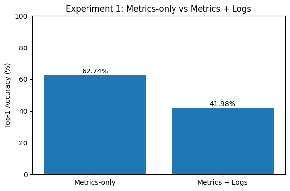
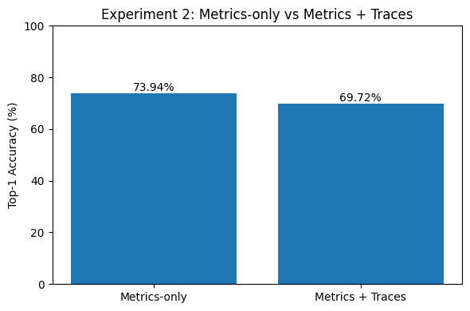
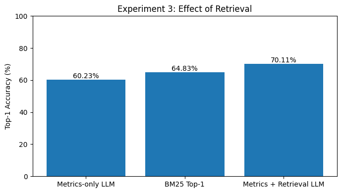
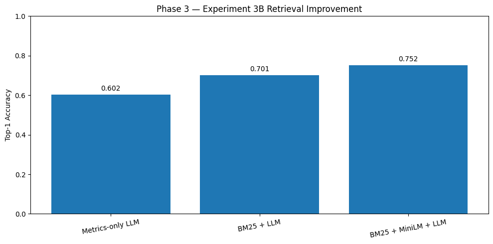
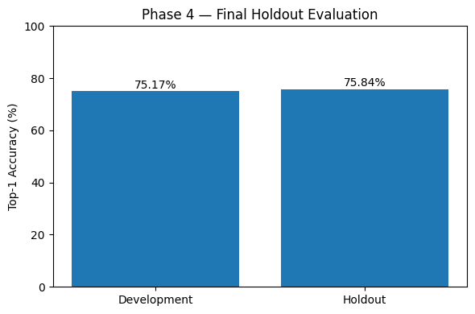
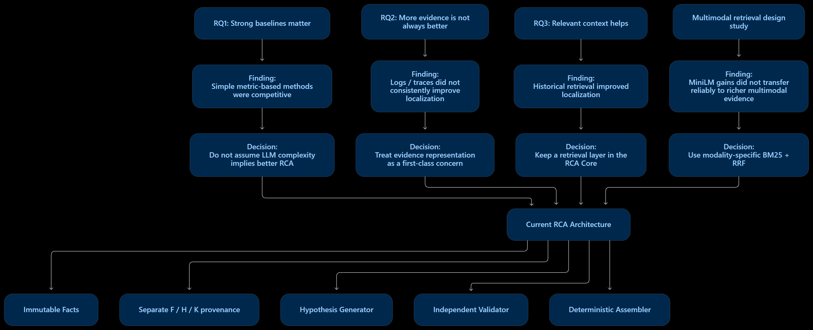

# Experiments & Research Findings

RCA AI began as an investigation into a fundamental question: **How can observability data and historical incident knowledge help identify failures in distributed systems?**

The initial research focused on root-cause service localization using RCAEval, an open-source benchmark for microservice root cause analysis. Through controlled experiments, the project compared simple metric-based methods, additional telemetry modalities, historical retrieval, and semantic reranking.

These experiments did not directly evaluate the current RCA Demo v1. Instead, they established several findings that influenced its design: simple baselines can be competitive, additional telemetry is not automatically beneficial, and historical retrieval can improve localization when the retrieved context is relevant.

The project subsequently evolved from predicting a single root-cause service toward an **evidence-grounded investigation assistant** that proposes and validates hypotheses.

This document presents the research through three questions, then explains how the findings informed the current architecture.

## 1. Research Questions

The experiments address three research questions:

| Research Question | Objective |
|---|---|
| **RQ1 — Baseline Effectiveness** | Determine whether more sophisticated RCA methods outperform simple metric-based approaches |
| **RQ2 — Evidence and Context** | Investigate whether additional telemetry or historical context improves LLM-based root-cause localization |
| **RQ3 — Retrieval and Reranking** | Evaluate whether semantic reranking improves historical retrieval and whether the selected localization pipeline maintains performance on held-out incidents |

Each question is presented through its motivation, experimental setup, findings, interpretation, and architectural implications.

The final section distinguishes **experimentally supported findings** from **subsequent engineering decisions**.

---

## 2. Benchmark and Experimental Methodology

### 2.1. RCAEval Benchmark

The research uses [RCAEval](https://github.com/phamquiluan/RCAEval), an open-source benchmark for root cause analysis in microservice systems.

**References**

- **Source code and evaluation framework:** [RCAEval — GitHub](https://github.com/phamquiluan/RCAEval)
- **Dataset:** [RCAEval — Hugging Face](https://huggingface.co/datasets/phamquiluan/RCAEval)
- **Benchmark paper:** [RCAEval — arXiv](https://arxiv.org/abs/2412.17015)

The dataset contains 735 incident runs spanning multiple systems and injected fault scenarios.

Each incident provides information about the injected failure and available observability evidence, which may include metrics, logs, and distributed traces.

The benchmark also provides ground-truth information used to evaluate root cause localization.

The research task is **root-cause service localization**: given the available telemetry for an incident, predict the service responsible for the injected failure.

This differs from generating a detailed, evidence-grounded causal explanation.

### 2.2. Preventing Ground-Truth Leakage

RCAEval includes repeated executions of the same injected-fault scenarios.

For example, multiple runs may share the same affected service and fault type while differing in telemetry measurements.

Randomly splitting individual runs could place closely related scenarios into both Development and Holdout sets.

To reduce this risk, the research groups repeated runs of the same scenario before splitting.

The final split constructed in the foundation notebook was:

| Partition | Incidents | Purpose |
|---|---:|---|
| Sandbox | 149 | Exploration, debugging, historical retrieval corpus |
| Development | 437 | Baseline comparison, controlled experiments, architecture selection |
| Holdout | 149 | Final evaluation after architecture selection |
| **Total** | **735** | |

The split contains no overlapping scenario groups.

Two Development incidents were later excluded from the metric-based evaluations because their recorded fault-injection timestamps fell outside the available telemetry range.

Consequently, the main baseline and retrieval experiments used **435 valid Development incidents**.

Ground-truth fields, such as `root_cause_service`, were excluded from the current incident's inference input and used for evaluation after predictions were generated.

Historical records in the Sandbox corpus could contain their known root causes as previously resolved examples.

[RCA Phase 1 — Foundation Notebook](notebooks/RCA_Phase_1_Foundation.ipynb) documents dataset exploration, ground-truth separation, and scenario-group splitting.

### 2.3. Evaluation Metrics

The primary metric was **Top-1 root-cause service accuracy**:

$$
\text{Top-1 Accuracy}
=
\frac{\text{Correctly localized incidents}}
{\text{Evaluated incidents}}
$$

Historical retrieval experiments additionally used:

- **Hit@K / Top-K coverage:** Whether a relevant historical incident appears among the first K retrieved candidates.
- **Mean Reciprocal Rank (MRR):** The average reciprocal position of the first relevant result.
- **Paired outcome comparison:** How often a proposed method corrects or worsens predictions relative to the baseline on the same incidents.

Execution latency was also recorded for selected baseline and inference configurations.

The benchmark measures localization effectiveness. It does not independently establish whether a natural-language explanation is causally grounded.

### 2.4. Language Model Configuration

The controlled localization experiments used **Qwen2.5-1.5B-Instruct**.

The experiments kept the model, decoding behavior, output parser, and current metric representation fixed when testing additional evidence or retrieval mechanisms.

This helped isolate the effect of each evaluated component.

The current RCA Demo v1 uses a different inference architecture and model configuration. Its performance must therefore be evaluated separately.

---

## 3. RQ1 — Do Sophisticated RCA Methods Outperform Simple Metric-Based Approaches?

### 3.1. Motivation

Distributed systems produce many correlated symptoms when an incident occurs.

A failing service may exhibit large changes in CPU usage, latency, memory consumption, or error rates. Downstream services may also become abnormal because failures propagate through dependencies.

A simple approach is to rank services using the magnitude of their metric changes.

More sophisticated alternatives include statistical RCA methods, historical incident retrieval, and LLM-based localization.

The first research question investigates whether this additional complexity leads to better results.

### 3.2. Experimental Setup

Four methods were evaluated on the same 435 valid Development incidents.

**Metric Change Heuristic**

A simple baseline that ranks changed metrics using relative differences between measurements before and after fault injection, then maps the highest-ranked metric to a service.

**BARO**

An existing metric-based RCA approach, evaluated using the implementation provided by RCAEval.

**BM25 Historical Retrieval**

A lexical retrieval baseline that represents incidents through changed metric names and uses the root-cause service associated with the top-ranked historical incident as its prediction.

**Metrics-only LLM**

A small language model that predicts the root-cause service from a structured representation of current metric changes.

All four approaches were evaluated using service-level Top-1 accuracy.

### 3.3. Results

| Method | Top-1 Accuracy | Average Latency |
|---|---:|---:|
| Metric Change Heuristic | **69.89%** | 23.7 ms |
| BM25 Retrieval | 64.83% | 27.5 ms |
| Metrics-only LLM | 60.23% | 758.9 ms |
| BARO | 52.87% | 164.4 ms |

The metric-change heuristic achieved the highest accuracy in this comparison.

It also required substantially less execution time than the evaluated LLM method.


[RCA Phase 2 — Baseline Notebook](notebooks/RCA_Phase_2_Baseline.ipynb) contains the metric heuristic, BARO, BM25, and metrics-only LLM baseline comparisons discussed here.

### 3.4. Why Did Simple Heuristics Perform Competitively?

The results suggest that large metric changes contain substantial information about injected faults in this benchmark.

For some incidents, resource anomalies are directly associated with the affected service.

However, the foundation and baseline notebooks also identified two important failure modes.

**Numerical instability**

Relative changes can become misleading when a metric's baseline value is zero or close to zero.

For example, a small increase in an error metric from zero can produce a disproportionately large anomaly score.

**Failure propagation**

A downstream service may exhibit a larger observable change than the service where the failure originated.

One baseline investigation found that the heuristic predicted `frontend-external` instead of the actual `productcatalogservice`, partly because a downstream error metric received an extremely large relative-change score.

This illustrates why identifying the most abnormal component is not equivalent to identifying the original failure source.

### 3.5. Answer to RQ1

**More sophisticated RCA methods did not consistently outperform the simple metric-change heuristic in the evaluated setting.**

The result demonstrates the importance of strong, inexpensive baselines.

It also exposes a limitation shared by several localization methods: observable symptoms can be more prominent than the originating fault.

The experiment does not establish that the heuristic is generally superior to BARO, retrieval-based methods, or LLMs.

### 3.6. Implications for RCA AI

The baseline findings motivated two directions.

First, additional architectural complexity needed to demonstrate measurable value rather than being introduced by default.

Second, improving localization might require additional information beyond the magnitude of metric changes.

This led to controlled experiments with logs, traces, and historical incident context.

---

## 4. RQ2 — Does Additional Telemetry or Retrieved Context Improve LLM-Based Localization?

### 4.1. Motivation

Metrics summarize system behavior but do not always explain why a failure occurred.

Application logs may contain error messages or configuration failures.

Distributed traces may expose operation delays and service dependencies.

Historical incidents may provide relevant examples of previously resolved failures.

These information sources could improve LLM reasoning, but they may also introduce distracting or misleading context.

RQ2 investigates whether adding each source improves the frozen Metrics-only LLM.

The experiments tested three alternatives separately:

1. Metrics + Logs
2. Metrics + Traces
3. Metrics + Historical Retrieval

The model configuration and current metric representation were held constant within the corresponding controlled comparisons.

### 4.2. Adding Log Evidence

The log experiment used lightweight log-template extraction.

The representation normalized dynamic values, grouped similar messages, compared their occurrence rates before and after fault injection, and retained selected templates.

The experiment evaluated the 212 Development incidents with log telemetry.

| Configuration | Top-1 Accuracy |
|---|---:|
| Metrics-only LLM | **62.74%** |
| Metrics + Logs | 41.98% |

The paired comparison showed:

- 19 predictions improved.
- 63 predictions worsened.
- The net result was 44 fewer correct predictions.



*Adding the tested normalized log-template representation was associated with lower aggregate accuracy in this comparison.*

The tested log representation substantially reduced aggregate localization accuracy.

A plausible limitation is that frequency-based templates may not preserve enough diagnostic meaning while still introducing substantial context.

This does not demonstrate that logs are inherently harmful.

Logs can contain valuable explanations, including explicit dependency failures, missing configurations, and exceptions. The experiment tested one particular representation and fusion strategy.

### 4.3. Adding Distributed Traces

The trace experiment investigated whether service-level and cross-service latency patterns could improve localization.

Trace evidence was constructed using:

- Top-5 service-level latency anomalies.
- Top-5 cross-service dependency latency anomalies.

Relationships were derived from trace and parent-span information.

The experiment evaluated 142 Development incidents with trace telemetry.

| Configuration | Top-1 Accuracy |
|---|---:|
| Metrics-only LLM | **73.94%** |
| Metrics + Traces | 69.72% |

The paired comparison showed:

- 21 predictions improved.
- 27 predictions worsened.
- The net result was six fewer correct predictions.



*The tested trace representation helped some incidents but reduced aggregate accuracy in this paired comparison.*

Traces corrected some metric-only failures, indicating that dependency information can provide useful complementary signals.

However, the unconditional combination reduced aggregate accuracy.

One underlying difficulty is that service latency can propagate through request dependencies. An affected caller may appear slower even when the originating fault lies elsewhere.

### 4.4. Adding Historical Incident Context

The third experiment used a different strategy.

Instead of supplying more current telemetry, the system retrieved previously resolved incidents with similar metric patterns.

The 149 Sandbox incidents formed a historical BM25 corpus.

Each Development query was represented using its Top-10 changed metric names.

BM25 retrieved the three highest-ranked historical incidents, which were supplied to the LLM as contextual examples together with their recorded root-cause services.

The historical examples were not treated as ground truth for the current incident.

The experiment evaluated all 435 valid Development incidents.

| Configuration | Top-1 Accuracy |
|---|---:|
| Metrics-only LLM | 60.23% |
| BM25 Retrieval Top-1 | 64.83% |
| Metrics + Retrieved Context + LLM | **70.11%** |

Compared with Metrics-only LLM, retrieval augmentation produced:

- An improvement of approximately 9.89 percentage points.
- 86 previously incorrect predictions corrected.
- 43 previously correct predictions worsened.
- A net increase of 43 correct predictions.



*Historical retrieval improved aggregate localization accuracy in the evaluated 435-incident Development set.*

The improvement was substantial within this experiment, but retrieval was not beneficial for every incident.

### 4.5. Answer to RQ2

**Additional context did not have a uniformly positive effect on LLM-based root-cause localization.**

Under the tested configurations:

- Adding normalized log-template evidence reduced aggregate accuracy.
- Adding structured trace evidence also reduced aggregate accuracy, despite helping some incidents.
- Adding retrieved historical incidents improved aggregate accuracy.

The comparisons involving logs and traces used different Development subsets and should be interpreted relative to their respective paired Metrics-only baselines, not directly compared against one another.

The results support a practical conclusion:

**The usefulness of context depends on its relevance and representation, not simply its volume.**

[RCA Phase 3 — Controlled Experiments Notebook](notebooks/RCA_Phase_3_ControlledExperiment.ipynb) contains the controlled log, trace, retrieval, and reranking experiments summarized in RQ2 and RQ3.

### 4.6. Implications for RCA AI

These findings motivated the project to treat evidence representation and contextual retrieval as explicit engineering concerns.

They also highlighted a risk in retrieval-augmented RCA: a retrieved incident may resemble the current symptoms but have a different cause.

This provided an important motivation for separating current observations from retrieved historical context.

It did not prove that any particular provenance or validation architecture was necessary. Those mechanisms were developed as subsequent engineering safeguards.

---

## 5. RQ3 — Can Semantic Reranking Improve Historical Retrieval and Downstream Localization?

### 5.1. Motivation

RQ2 showed that historical retrieval improved localization on the evaluated metric-based task.

However, BM25 relies primarily on lexical overlap.

It may rank a historical incident highly because it shares metric names with the current incident, even when another candidate has a more relevant overall failure pattern.

RQ3 investigates whether a lightweight semantic reranker can improve the ordering of BM25 candidates.

It also examines whether those retrieval improvements affect downstream localization accuracy and remain stable on held-out incidents.

### 5.2. Experimental Setup

The proposed retrieval pipeline was:

```text
Current Incident
      |
      v
Top-10 Changed Metric Names
      |
      v
BM25 Top-10 Historical Candidates
      |
      v
MiniLM Cross-Encoder Reranking
      |
      v
Reranked Top-3 Historical Incidents
      |
      v
Qwen2.5-1.5B-Instruct
      |
      v
Predicted Root-Cause Service
```

MiniLM only reordered the existing BM25 Top-10 candidate pool.

It did not retrieve additional incidents.

The downstream LLM prompt retained the same current metric representation and inference configuration. Only the retrieved historical context changed.

This allowed the experiment to examine whether improved retrieval ranking translated into improved localization.

### 5.3. Retrieval-Level Results

| Metric | BM25 | BM25 + MiniLM |
|---|---:|---:|
| Top-1 | 64.83% | **71.95%** |
| Top-3 coverage | 74.25% | **82.76%** |
| MRR@10 | 0.7234 | **0.7860** |
| Top-10 coverage | 94.02% | 94.02% |

MiniLM improved the ordering of candidates within the unchanged Top-10 pool.

The Top-10 coverage remained the same because reranking could not recover relevant incidents absent from the original candidate set.

These results support the usefulness of semantic reranking for the compact metric-token representation evaluated here.

### 5.4. Downstream Localization Results

The complete reranking pipeline was then evaluated on the same 435 valid Development incidents.

| Configuration | Top-1 Accuracy |
|---|---:|
| Metrics-only LLM | 60.23% |
| BM25 + LLM | 70.11% |
| BM25 + MiniLM + LLM | **75.17%** |



*The chart summarizes downstream localization results; retrieval-level ranking metrics are reported separately above.*

Compared with BM25 + LLM, the MiniLM-reranked pipeline achieved:

- 46 improved predictions.
- 24 worsened predictions.
- A net gain of 22 correct predictions.
- An absolute accuracy improvement of approximately 5.06 percentage points.

The selected pipeline increased Development Top-1 accuracy from 60.23% for Metrics-only LLM to 75.17%.

The results demonstrate that better historical candidate ordering can improve downstream localization in this tested representation.

However, reranking still worsened some individual predictions.

### 5.5. Final Holdout Evaluation

After selecting the strongest Development configuration, the pipeline was frozen.

The final architecture was:

**Metric evidence → BM25 Top-10 → MiniLM reranking → Top-3 historical context → Qwen2.5-1.5B-Instruct.**

The same representation, retrieval configuration, model, prompt, and parser were used for the previously untouched Holdout split.

Ground-truth labels were introduced only after predictions had been generated and saved.

| Evaluation Partition | Correct / Total | Top-1 Accuracy |
|---|---:|---:|
| Development | 327 / 435 | 75.17% |
| Holdout | 113 / 149 | **75.84%** |

The Holdout evaluation also recorded five unparsed LLM outputs.



*The frozen configuration had similar observed Top-1 accuracy on the two reported partitions.*

[RCA Phase 4 — Final Holdout Evaluation Notebook](notebooks/RCA_Phase_4_FinalHoldoutEvaluation.ipynb) documents reconstruction and evaluation of the frozen pipeline on Holdout.

The Holdout accuracy was approximately 0.67 percentage points higher than the Development result.

This comparison did not show a large performance collapse after Development-based architecture selection.

Nevertheless, it does not establish statistical equivalence, eliminate all risks of overfitting, or demonstrate generalization to production incidents.

### 5.6. Answer to RQ3

**Semantic reranking improved both historical retrieval ranking and downstream root-cause localization in the evaluated compact metric-based setup.**

The selected pipeline maintained similar observed Top-1 accuracy on the untouched Holdout split.

The findings support a two-stage retrieval approach for this particular benchmark representation.

They do not establish that MiniLM is the best reranker for arbitrary observability evidence or that this localization pipeline is equivalent to the current RCA Demo v1.

---

## 6. From Research Findings to the Current RCA Architecture

The RCAEval experiments established which approaches improved root-cause service localization under controlled metric-based conditions.

The subsequent engineering work addressed a different objective:

**How can the system produce useful explanations while preserving the distinction between observed evidence, retrieved context, and inferred causes?**

The current RCA Core is not a direct deployment of the highest-scoring RCAEval pipeline.

It incorporates lessons from that research while introducing new requirements for evidence fidelity, provenance, uncertainty, and reproducible execution.

### 6.1. Reconsidering Retrieval for Multimodal Evidence

The positive MiniLM results were obtained using compact representations dominated by changed metric names.

The later RCA Core needed to handle richer evidence involving metrics, logs, traces, and Kubernetes observations.

A separate **Multimodal Retrieval Design Study** investigated whether the earlier reranking approach transferred to this richer representation.

The study used a small seeded corpus of 22 historical records and nine incident queries.

One relevant comparison reported:

| Retrieval Design | Hit@1 | Hit@3 |
|---|---:|---:|
| Mixed BM25 | 4/9 | 9/9 |
| Mixed BM25 + MiniLM | 1/9 | 6/9 |
| Split-raw modality-specific BM25 + RRF | 5/9 | 9/9 |

The semantic reranking benefit previously observed with compact metric representations did not transfer reliably to this richer setup.

A simpler combination of modality-specific BM25 and Reciprocal Rank Fusion provided a practical alternative.

This comparison changed more than one design factor, including representation, indexing, and rank fusion. It therefore does not isolate the benefit of modality separation alone.

The small evaluation is useful as engineering evidence, but insufficient to establish general retrieval superiority.

**Design decision:** The current RCA Core uses modality-specific BM25 retrieval with RRF, without MiniLM reranking.

<!-- OPTIONAL RESEARCH ARTIFACT TODO:
If the original Multimodal Retrieval Design Study reports are published,
link the consolidated experiment summary here.

Do not add a separate notebook reference unless a matching notebook is verified.

Suggested label:
Multimodal Retrieval Design Study — Controlled Seeded Evaluation.
-->

### 6.2. Separating Observations from Retrieved Context

The RCAEval localization experiments used known historical root-cause services as contextual information.

That was appropriate for the retrieval-augmented benchmark experiment.

However, historical similarity does not prove that the same cause applies to a new incident.

The current RCA Core therefore separates:

| Information | Role |
|---|---|
| **F — Current Facts** | Source-linked observations from the incident |
| **H — Historical Incidents** | Previously recorded precedents |
| **K — Domain Knowledge** | Sourced general operational information |
| **Hypotheses** | Proposed explanations of the current incident |

Current Facts are constructed deterministically from prepared canonical evidence.

Historical and Knowledge references support interpretation without being promoted into current-incident observations.

**Design decision:** Use immutable Facts and explicit provenance namespaces.

This is a source-integrity requirement of the current architecture, not an independently validated result of the RCAEval experiments.

### 6.3. Moving Beyond a Single Root-Cause Prediction

The research experiments primarily evaluated whether a method predicted the correct root-cause service.

That is a useful benchmark objective, but it does not measure whether the system can produce a sufficiently grounded causal explanation.

For example, an LLM might correctly predict `payment` while giving an unsupported explanation of why Payment failed.

The current RCA Core addresses this different problem by separating:

1. Hypothesis generation.
2. Independent hypothesis validation.
3. Deterministic result assembly.

The Generator may propose multiple explanations or abstain.

The Validator can retain, qualify, or reject each candidate according to its evidential support.

The Assembler preserves validated wording and references without another LLM rewrite.

**Design decision:** Treat root-cause explanations as evidence-grounded hypotheses rather than automatically confirmed diagnoses.

This design requires separate evaluation through the prepared-demo verification process.

### 6.4. Maintaining Explicit Execution Boundaries

The richer RCA Core also encountered practical request-size and provider constraints.

Rather than silently truncating current evidence, the supported Demo v1 begins with bounded prepared canonical inputs and preserves every supplied Fact through the reasoning pipeline.

Complete requests exceeding the configured internal budget fail visibly.

This is an execution-integrity decision.

It should not be confused with a finding that the selected evidence is causally complete or that every important observation has been captured upstream.

### 6.5. Research-to-Architecture Summary

| Finding or Design Concern | Consequence for RCA AI |
|---|---|
| Simple metric-based methods can be competitive | Evaluate complexity against meaningful baselines |
| Large metric changes can reflect propagated symptoms | Avoid equating the largest anomaly with confirmed causality |
| Adding logs or traces did not consistently help the tested LLM | Treat evidence representation and relevance as first-class concerns |
| Retrieved history improved metric-based localization | Retain a historical context retrieval layer |
| MiniLM improved compact metric-based ranking but did not transfer reliably to richer evidence | Select modality-specific BM25 + RRF for the current demo |
| Historical similarity is not proof of the current cause | Separate F/H/K provenance |
| Service localization does not evaluate explanation groundedness | Introduce hypothesis generation, independent validation, and explicit uncertainty |
| Evidence reduction may hide relevant information | Preserve supplied canonical Facts and fail visibly on oversized requests |



*The diagram distinguishes benchmark findings from later architecture decisions.*

The architectural decisions are motivated by these findings and subsequent engineering requirements.

They should not be interpreted as jointly proven optimal by the earlier benchmark results.

---

## 7. Threats to Validity and Limitations

### 7.1. Benchmark Representativeness

RCAEval provides controlled fault-injection incidents with known ground-truth labels.

These are useful for reproducible method comparisons.

However, their failure patterns and telemetry distributions may not capture the full complexity of production incidents, including multiple simultaneous causes, incomplete instrumentation, and evolving system configurations.

### 7.2. Subset Comparability

The log, trace, and full metric-based experiments evaluated different subsets.

In particular:

- Metrics + Logs was evaluated on 212 incidents.
- Metrics + Traces was evaluated on 142 incidents.
- Retrieval augmentation was evaluated on 435 incidents.

Therefore, the absolute accuracies from those separate experiments should not be combined into a single method ranking.

The relevant comparisons are paired within each experiment.

### 7.3. Representation Dependence

The experiments tested specific ways of extracting and presenting telemetry.

A negative result for normalized log-template frequency changes does not establish that other log representations would also fail.

Similarly, the semantic reranking results depended on compact metric-token inputs.

Their performance should not be assumed to transfer unchanged to richer multimodal evidence.

### 7.4. Evaluation Granularity

Top-1 service accuracy measures whether the predicted service matches the labeled root-cause service.

It does not measure:

- Accuracy of a natural-language causal explanation.
- Correctness of individual supporting claims.
- Completeness of the evidence considered.
- Usefulness of recommended investigation steps.
- Reduction in Mean Time to Resolution.

These require separate evaluation protocols.

### 7.5. Generalization and Statistical Uncertainty

The frozen Holdout result was close to Development performance.

This provides a useful consistency check, but one held-out evaluation does not prove generalization to unseen production environments.

The smaller multimodal retrieval study is particularly sensitive to individual query outcomes and should not be used to make broad statistical claims.

### 7.6. Current Demo v1 Is a Different Evaluation Target

The evaluated RCAEval pipeline used compact metric evidence, BM25, MiniLM, and Qwen2.5-1.5B-Instruct for service localization.

The current Demo v1 uses prepared canonical evidence, modality-specific retrieval, hypothesis generation, independent validation, and deterministic assembly.

The RCAEval results are part of the project's research history, not a direct measurement of the current demo's diagnostic accuracy.

---

## 8. Reproducibility and Research Artifacts

The experimental notebooks document the benchmark preparation, baseline implementation, controlled comparisons, and final Holdout evaluation.

The recommended repository organization is:

```text
notebooks/
  RCA_Phase_1_Foundation.ipynb
  RCA_Phase_2_Baseline.ipynb
  RCA_Phase_3_ControlledExperiment.ipynb
  RCA_Phase_4_FinalHoldoutEvaluation.ipynb

docs/
  experiments.md
  core-design.md
  evaluation.md
  assets/
    experiments/
      ...
```

The notebook filenames preserve the original research workflow. The narrative in this document is organized by Research Questions instead.

### Notebook References

1. [RCA Phase 1 — Foundation](notebooks/RCA_Phase_1_Foundation.ipynb) — dataset exploration, ground-truth separation, and scenario-group split.
2. [RCA Phase 2 — Baselines](notebooks/RCA_Phase_2_Baseline.ipynb) — baseline localization methods.
3. [RCA Phase 3 — Controlled Experiments](notebooks/RCA_Phase_3_ControlledExperiment.ipynb) — log, trace, historical retrieval, and MiniLM comparisons.
4. [RCA Phase 4 — Final Holdout Evaluation](notebooks/RCA_Phase_4_FinalHoldoutEvaluation.ipynb) — frozen pipeline reconstruction and Holdout evaluation.

### Figure References

The primary figures proposed for this document are:

| Figure | Source |
|---|---|
| Baseline method comparison | Baseline notebook |
| Metrics-only versus Metrics + Logs | Controlled Experiment notebook |
| Metrics-only versus Metrics + Traces | Controlled Experiment notebook |
| Historical retrieval augmentation | Controlled Experiment notebook |
| BM25 versus MiniLM downstream localization | Controlled Experiment notebook |
| Development versus Holdout | Final Holdout notebook |
| Research-to-architecture evolution | [Research-to-architecture diagram](assets/research-to-architecture.png) |

Only figures needed to support the central research narrative should be included.

Additional exploratory plots and detailed diagnostics can remain in the notebooks.

### Reproduction Notes

The reported measurements were obtained using the original research environment and experiment configurations.

Reproducing them requires the relevant RCAEval dataset, split definitions, model configurations, and saved intermediate artifacts.

The current prepared-demo fixtures are separate from the RCAEval benchmark data and should not be used as substitutes for the original evaluation datasets.

---

## 9. Conclusion

The research provides three main answers.

**RQ1 — Baseline Effectiveness:** More sophisticated RCA methods did not consistently outperform a simple metric-change heuristic in the evaluated benchmark. Strong baselines are necessary, and large symptoms do not necessarily identify the originating failure.

**RQ2 — Evidence and Context:** Adding telemetry did not automatically improve LLM localization. Historical retrieval improved the evaluated metric-based LLM, suggesting that relevant contextual information can be more useful than simply increasing the amount of evidence.

**RQ3 — Retrieval and Reranking:** MiniLM improved both historical ranking and downstream localization for compact metric-based representations. The selected pipeline achieved 75.17% Development Top-1 accuracy and 75.84% on the untouched Holdout split.

These findings helped shape the project's engineering direction.

The current RCA Core builds on the value of retrieval while addressing a different problem: producing source-linked investigation hypotheses with explicit uncertainty.

Its design emphasizes immutable evidence, separate contextual knowledge, independent validation, and deterministic assembly.

**The research established useful localization findings; the current RCA Core extends the project toward evidence-grounded incident investigation.**

The performance and investigative usefulness of that current architecture are evaluated separately in [Evaluation](evaluation.md).

---

## Related Documentation

- [System Architecture](architecture.md) — Current RCA Core and Demo v1 architecture.
- [Core Design](core-design.md) — Detailed engineering decisions and trade-offs.
- [Evaluation](evaluation.md) — Prepared-scenario verification and current demo limitations.
- [Project README](../README.md) — Overview, live demo, and setup.
